<div align="center">

# StockFlow — Inventory Management System API

<p align="center">
  <strong>A high-throughput, multi-warehouse SaaS Inventory Management REST API and Razor MVC application built with ASP.NET Core 8, Entity Framework Core, SQL Server, and AI-assisted inventory replenishment insights.</strong>
</p>

[](https://github.com/Dhanya562004/stockflow-inventory-api/actions/workflows/ci.yml)
[](https://github.com/Dhanya562004/stockflow-inventory-api/actions/workflows/legacy-ci.yml)
[](https://dotnet.microsoft.com/)
[](https://learn.microsoft.com/dotnet/csharp/)
[](https://dotnet.microsoft.com/apps/aspnet)
[](https://learn.microsoft.com/ef/core/)
[](https://www.microsoft.com/sql-server)
[](https://jwt.io/)
[](https://fluentvalidation.net/)
[](https://xunit.net/)
[](https://dhanya-stockflow.runasp.net/)

<p align="center">
  <a href="https://dhanya-stockflow.runasp.net/"><strong>🌐 Live Application</strong></a> •
  <a href="https://dhanya-stockflow.runasp.net/swagger/index.html"><strong>📖 Swagger API Documentation</strong></a> •
  <a href="https://dhanya-stockflow.runasp.net/health"><strong>🩺 Production Health Check</strong></a> •
  <a href="https://github.com/Dhanya562004/stockflow-inventory-api"><strong>💻 GitHub Repository</strong></a> •
  <a href="https://github.com/Dhanya562004/stockflow-inventory-api/actions"><strong>🚀 GitHub Actions</strong></a>
</p>

</div>

> [!NOTE]
> **StockFlow Core Highlights:** Developed and maintained by **Dhanya K.** ([github.com/Dhanya562004](https://github.com/Dhanya562004)), StockFlow provides multi-warehouse inventory tracking, atomic dual-entity database transactions, row-version optimistic concurrency handling, raw SQL aggregation reports, an AI Replenishment Advisor calling LLM APIs, an isolated .NET Framework 4.8 / ASP.NET MVC 5 legacy sidecar, automated SQL Server container integration tests, and multi-stage CI/CD workflows.

---

## Table of Contents

- [1. Project Overview](#1-project-overview)
- [2. Skills Evidence Map](#2-skills-evidence-map)
- [3. Engineering Scope and Contributions](#3-engineering-scope-and-contributions)
- [4. Live Demo and Useful Links](#4-live-demo-and-useful-links)
- [5. Screenshots](#5-screenshots)
- [6. Key Features](#6-key-features)
- [7. Technology Stack](#7-technology-stack)
- [8. Architecture Overview](#8-architecture-overview)
- [9. Legacy .NET Framework Sidecar](#9-legacy-net-framework-sidecar)
- [10. Application Modules](#10-application-modules)
- [11. API Endpoints](#11-api-endpoints)
- [12. Authentication and Authorization](#12-authentication-and-authorization)
- [13. Database Design](#13-database-design)
- [14. Installation and Local Setup](#14-installation-and-local-setup)
- [15. Environment Variables and Configuration](#15-environment-variables-and-configuration)
- [16. Running the Application](#16-running-the-application)
- [17. Testing and Test Results](#17-testing-and-test-results)
- [18. CI/CD Pipeline](#18-cicd-pipeline)
- [19. Deployment](#19-deployment)
- [20. Project Structure](#20-project-structure)
- [21. Architectural Decision Records (ADRs)](#21-architectural-decision-records-adrs)
- [22. Engineering Process and Quality Standards](#22-engineering-process-and-quality-standards)
- [23. Known Limitations](#23-known-limitations)
- [24. Future Improvements](#24-future-improvements)
- [25. License and Project Attribution](#25-license-and-project-attribution)

---

## 1. Project Overview

**StockFlow** is a backend-focused Inventory Management System engineered within the **ASP.NET Core 8** ecosystem to demonstrate reliable inventory operations, multi-warehouse stock tracking, and brownfield enterprise migration patterns.

Managing inventory at scale requires strict data consistency across sales channels, multi-location storage facilities, and high-frequency order processing. StockFlow addresses these engineering challenges with:

- **Multi-Warehouse Stock Isolation:** Independent stock tracking per location (`WH-MAIN`, `WH-SECONDARY`) with atomic catalog total synchronization.
- **Concurrency & Double-Selling Prevention:** RowVersion optimistic concurrency tokens and database execution strategy transactions that mitigate race conditions and prevent overselling under 20-thread concurrency integration testing.
- **Reporting & Business Intelligence:** Parameterized raw SQL queries for performant aggregation across multi-location records without SQL injection risk.
- **AI Inventory Replenishment Advisor:** Automated stock analysis utilizing large language models (LLMs) to synthesize stock thresholds into actionable purchasing guidance (verified via `MockLlmClient` in CI; live OpenAI API calls require an active API key).
- **Legacy Modernization Sidecar:** A buildable, isolated **.NET Framework 4.8 / ASP.NET MVC 5** sidecar project modeling the architecture and testing patterns of systems undergoing cloud migration.
- **Engineering Architecture & ADRs:** Comprehensive documentation including [System Architecture](docs/architecture.md), [Design Decisions (ADRs)](docs/design-decisions.md), and [AI-Assisted Workflow & Case Studies](docs/ai-workflow.md).

---

## 2. Skills Evidence Map

The following matrix maps key software engineering requirements directly to tangible source code, configuration files, and verifiable test evidence in this repository:

| Engineering Requirement | Evidence in this Repository | Verification Method & Status |
| :--- | :--- | :--- |
| **C# and .NET** | [`Controllers/`](Controllers/), [`Services/`](Services/), [`Data/AppDbContext.cs`](Data/AppDbContext.cs) | Inspected code; compiled cleanly via `dotnet build InventoryManagementSystemAPI.sln` on .NET 8.0 SDK (0 errors, 0 warnings). |
| **.NET Framework / ASP.NET MVC** | [`legacy/StockFlow.LegacyMvc5/`](legacy/StockFlow.LegacyMvc5/), [`legacy/StockFlow.LegacyMvc5.Tests/`](legacy/StockFlow.LegacyMvc5.Tests/) | Compiled with Windows MSBuild; tested with xUnit/Moq; [Last successful run: #42837730376](https://github.com/Dhanya562004/stockflow-inventory-api/actions/runs/42837730376) verified `success`. |
| **SQL and SQL Server** | Low-stock raw SQL report ([`Controllers/ReportsController.cs`](Controllers/ReportsController.cs), [`Services/Implementations/ReportService.cs`](Services/Implementations/ReportService.cs)), `RowVersion` concurrency tokens, `executionStrategy.ExecuteAsync` transactions, [`Migrations/`](Migrations/) | EF Core migrations applied; SQL Server integration tests passing in CI (46 of 48 .NET tests pass in CI, including integration tests). |
| **HTML, CSS, JavaScript, DOM** | [`wwwroot/js/stock.js`](wwwroot/js/stock.js), [`tests/js/`](tests/js/) (Jest) | 12 Jest unit tests passing via `npm test --prefix tests/js` verifying DOM mutations, error message rendering, and XSS prevention. |
| **HTTP and REST** | Endpoint table in Section 11; status codes `200`, `400`, `401`, `403`, `404`, `409`, `500`, `503` | Verified via live Swagger UI at `/swagger/index.html` and HTTP status assertions in automated integration test suites. |
| **Unit & Integration Testing** | [`InventoryManagementSystemAPI.Tests/`](InventoryManagementSystemAPI.Tests/) (xUnit, Moq), [`legacy/StockFlow.LegacyMvc5.Tests/`](legacy/StockFlow.LegacyMvc5.Tests/) (xUnit, Moq) | 46 of 48 .NET tests pass in CI (2 skipped); 10 of 11 legacy .NET Framework 4.8 tests pass in Windows CI (1 skipped). |
| **Git & Version Control** | Feature branches, PRs ([#15](https://github.com/Dhanya562004/stockflow-inventory-api/pull/15) through [#24](https://github.com/Dhanya562004/stockflow-inventory-api/pull/24)), conventional commits, `git log` | Linear Git history verified with `git log --oneline` showing structured pull request workflow. |
| **CI/CD Automation** | [`.github/workflows/ci.yml`](.github/workflows/ci.yml), [`.github/workflows/legacy-ci.yml`](.github/workflows/legacy-ci.yml) | Automated GitHub Actions pipelines; Linux runner executing .NET 8 + SQL Server container; Windows runner executing .NET Framework 4.8 MSBuild. |
| **AI / LLM Engineering** | [`Services/Implementations/OpenAiLlmClient.cs`](Services/Implementations/OpenAiLlmClient.cs), [`Controllers/ReportsController.cs`](Controllers/ReportsController.cs) (low-stock summary prompt, structured JSON schema, and HTTP 503 fallback) | Verified in CI using `MockLlmClient` test fixtures without external API dependency; live OpenAI tests runnable via `OPENAI_API_KEY`. |
| **AI Development Tools & Review** | [`docs/ai-workflow.md`](docs/ai-workflow.md) (4 real cases of catching AI errors) | 4 real-world case studies documenting detection and remediation of AI defects (MSBuild item recursion, dynamic binding, solution collision, incomplete assertions). |
| **Code Review & Quality Standards** | [`.github/pull_request_template.md`](.github/pull_request_template.md), [`docs/code-review-checklist.md`](docs/code-review-checklist.md) *(located in `docs/`)*, [`.github/ISSUE_TEMPLATE/`](.github/ISSUE_TEMPLATE/), reviewed [PR #21](https://github.com/Dhanya562004/stockflow-inventory-api/pull/21) | Process enforcement across PRs; code review checklist auditing authorization, input validation, and transaction boundaries. |
| **Software Architecture & Design** | [`docs/architecture.md`](docs/architecture.md), [`docs/design-decisions.md`](docs/design-decisions.md) (6 ADRs) | Architecture specifications with Mermaid diagrams and 6 Architectural Decision Records (ADR-001 through ADR-006). |

*(Note on path verification: All paths above were verified against the repository file tree. The code review checklist is stored in `docs/code-review-checklist.md`, and browser end-to-end tests reside in `tests/js/e2e/stock.spec.js`).*

---

## 3. Engineering Scope and Contributions

StockFlow originated from a foundational inventory Web API architecture and was systematically upgraded, refactored, and extended by **Dhanya K.** to incorporate enterprise data consistency, multi-location stock tracking, optimistic concurrency protection, and legacy migration benchmarks.

### Foundational Architecture vs. Advanced Extensions

#### Foundational Baseline
- Initial CRUD API endpoints for Products, Categories, Suppliers, and Purchase Orders.
- Base Entity Framework Core DbContext and initial relational schema.
- Initial ASP.NET Core Identity setup and basic JWT authentication pipeline.

#### Advanced Architecture & Implementations (Dhanya K.)
1. **Optimistic Concurrency Control:** Implemented SQL Server `RowVersion` timestamp tokens mapped to `Product` and `StockLevel` entities, added retry loops with exponential backoff and jitter, handled `DbUpdateConcurrencyException` with entity reloads (`ReloadAsync()`), and returned semantic `HTTP 409 Conflict` responses ([PR #16](https://github.com/Dhanya562004/stockflow-inventory-api/pull/16), commits `2f48abb`, `434f507`).
2. **Multi-Warehouse Stock Tracking:** Introduced the `StockLevel` entity for independent per-location inventory tracking (`WH-MAIN`, `WH-SECONDARY`), built atomic adjustment endpoints (`POST /api/stock/adjust` and `POST /api/stock/locations/adjust`), and implemented EF Core execution strategy transactions reconciling warehouse levels with catalog totals ([PR #16](https://github.com/Dhanya562004/stockflow-inventory-api/pull/16), commit `e33e4c4`, [PR #19](https://github.com/Dhanya562004/stockflow-inventory-api/pull/19)).
3. **High-Performance Low-Stock Reporting:** Engineered a parameterized raw SQL aggregation query (`Database.SqlQuery<LowStockReportDto>`) using `INNER JOIN`, `GROUP BY`, and `HAVING SUM(sl.Quantity) <= @threshold` to aggregate multi-warehouse stock without SQL injection vulnerability ([PR #21](https://github.com/Dhanya562004/stockflow-inventory-api/pull/21), commit `6be24b5`).
4. **AI Inventory Replenishment Advisor:** Designed the `ILlmClient` abstraction, implemented `OpenAiLlmClient` calling OpenAI's structured JSON API, authored prompt templates, configured HTTP 503 fallback handling for unconfigured keys or network outages, and built `MockLlmClient` for deterministic CI execution (commits `7000f25`, `4d97ff9`, `ce2bdbf`, [PR #21](https://github.com/Dhanya562004/stockflow-inventory-api/pull/21)).
5. **Comprehensive Automated Test Suite:** Implemented test suites across 3 projects: 48 .NET tests (46 passing in CI, 2 skipped, including 14 SQL Server integration tests), 11 legacy .NET Framework tests (10 passing in Windows CI, 1 skipped), 12 Jest unit tests verifying DOM rendering and XSS prevention, and Playwright E2E browser automation ([PR #18](https://github.com/Dhanya562004/stockflow-inventory-api/pull/18), [PR #21](https://github.com/Dhanya562004/stockflow-inventory-api/pull/21), [PR #23](https://github.com/Dhanya562004/stockflow-inventory-api/pull/23)).
6. **Legacy .NET Framework Sidecar:** Created an isolated .NET Framework 4.8 / ASP.NET MVC 5 + Web API 2 project in `legacy/StockFlow.LegacyMvc5` with `Global.asax`, `Web.config`, ADO.NET data access with transactions and `UPDLOCK` hints, and an xUnit/Moq test suite ([PR #15](https://github.com/Dhanya562004/stockflow-inventory-api/pull/15), [PR #21](https://github.com/Dhanya562004/stockflow-inventory-api/pull/21), [PR #22](https://github.com/Dhanya562004/stockflow-inventory-api/pull/22)).
7. **Multi-Platform CI/CD Pipelines:** Configured GitHub Actions workflows: `.github/workflows/ci.yml` (Ubuntu runner, SQL Server 2022 container, Coverlet code coverage enforcement) and `.github/workflows/legacy-ci.yml` (Windows runner, MSBuild compilation, xUnit/Moq test runner) (commit `68778a3`, [PR #15](https://github.com/Dhanya562004/stockflow-inventory-api/pull/15), [PR #21](https://github.com/Dhanya562004/stockflow-inventory-api/pull/21), [PR #22](https://github.com/Dhanya562004/stockflow-inventory-api/pull/22)).
8. **Engineering Documentation & Standards:** Created 6 Architectural Decision Records ([docs/design-decisions.md](docs/design-decisions.md)), system architecture diagrams ([docs/architecture.md](docs/architecture.md)), AI workflow case studies ([docs/ai-workflow.md](docs/ai-workflow.md)), pull request template ([.github/pull_request_template.md](.github/pull_request_template.md)), and code review checklist ([docs/code-review-checklist.md](docs/code-review-checklist.md)) ([PR #20](https://github.com/Dhanya562004/stockflow-inventory-api/pull/20), [PR #21](https://github.com/Dhanya562004/stockflow-inventory-api/pull/21), [PR #24](https://github.com/Dhanya562004/stockflow-inventory-api/pull/24)).

---

## 4. Live Demo and Useful Links

The modern .NET 8 application is deployed and actively running on a production Windows Server IIS environment.

| Resource | URL | Status / Verification Note |
| :--- | :--- | :--- |
| **Live Web Interface** | [dhanya-stockflow.runasp.net](https://dhanya-stockflow.runasp.net/) | HTTP 200 — Stock adjustment & AI advisor page |
| **Swagger API Explorer** | [dhanya-stockflow.runasp.net/swagger/index.html](https://dhanya-stockflow.runasp.net/swagger/index.html) | HTTP 200 — Interactive OpenAPI documentation |
| **Production Health Check** | [dhanya-stockflow.runasp.net/health](https://dhanya-stockflow.runasp.net/health) | HTTP 200 — Returns `{"status":"Healthy"}` |
| **GitHub Repository** | [github.com/Dhanya562004/stockflow-inventory-api](https://github.com/Dhanya562004/stockflow-inventory-api) | Main codebase and issue tracker |
| **GitHub Actions CI/CD** | [github.com/Dhanya562004/stockflow-inventory-api/actions](https://github.com/Dhanya562004/stockflow-inventory-api/actions) | Automated test, build, and coverage runs |

### Production Verification (as of November 10, 2026)
- **Root Web Page (`/stock`):** Returned HTTP 200 with dynamic catalog rendering.
- **Swagger Documentation (`/swagger`):** Returned HTTP 200 with complete schema listings.
- **Health Check (`/health`):** Returned HTTP 200 with status `Healthy`.
- **Public Products Endpoint (`GET /api/Products`):** Returned HTTP 200 with seeded inventory records.
- **Low-Stock Report (`GET /api/Reports/low-stock`):** Returned HTTP 200 with aggregated database counts.
- **Protected Endpoints (`Categories`, `Suppliers`):** Returned HTTP 401 Unauthorized when accessed without a JWT Bearer token, confirming RBAC enforcement.

---

## 5. Screenshots

<details>
<summary><strong>View Application Screenshots (Authentication, Products, and Roles)</strong></summary>
<br />

| User Login | User Registration |
| :---: | :---: |
| 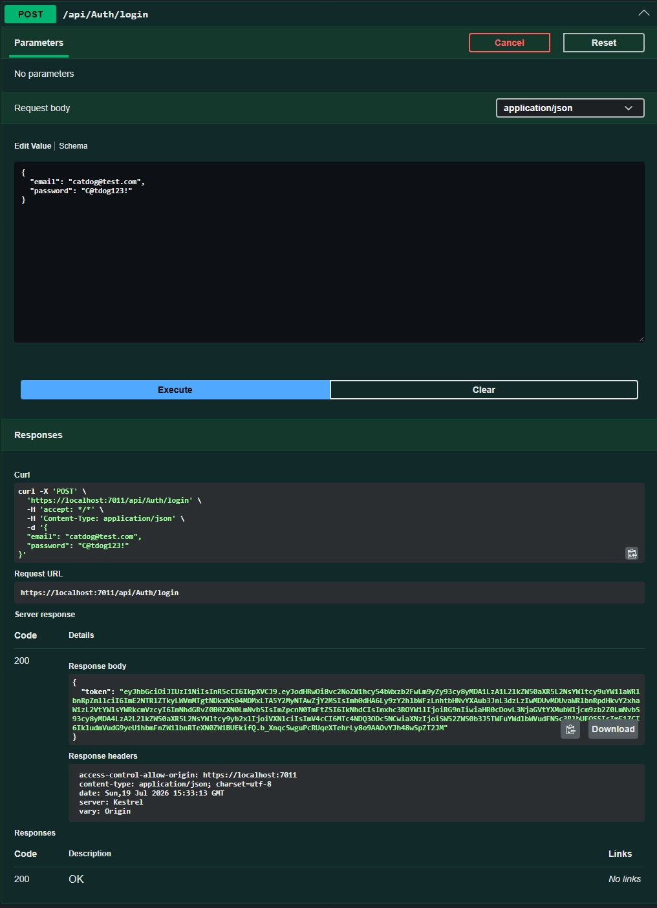 | 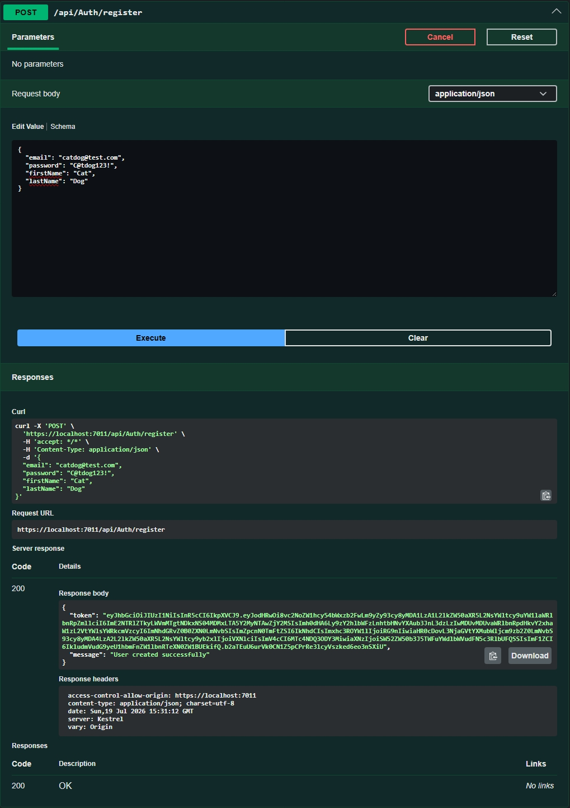 |

| Get All Products | Get Product by ID |
| :---: | :---: |
| 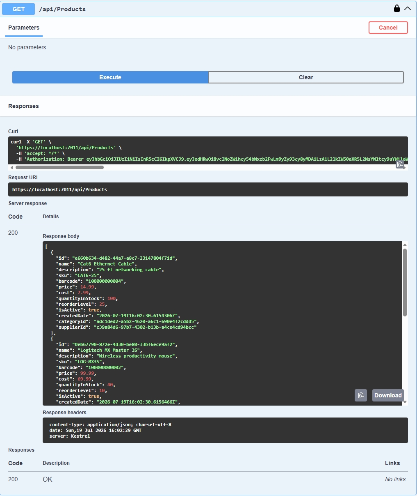 | 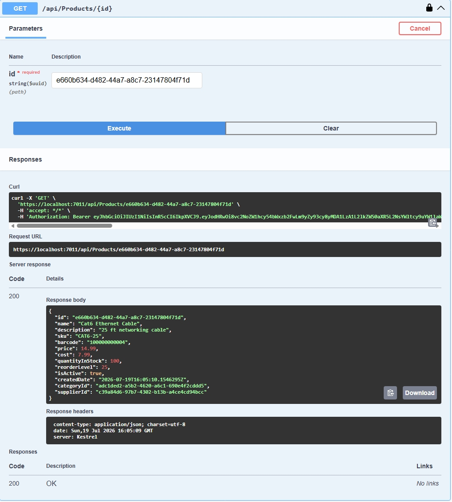 |

| Create Product | Update Product |
| :---: | :---: |
| 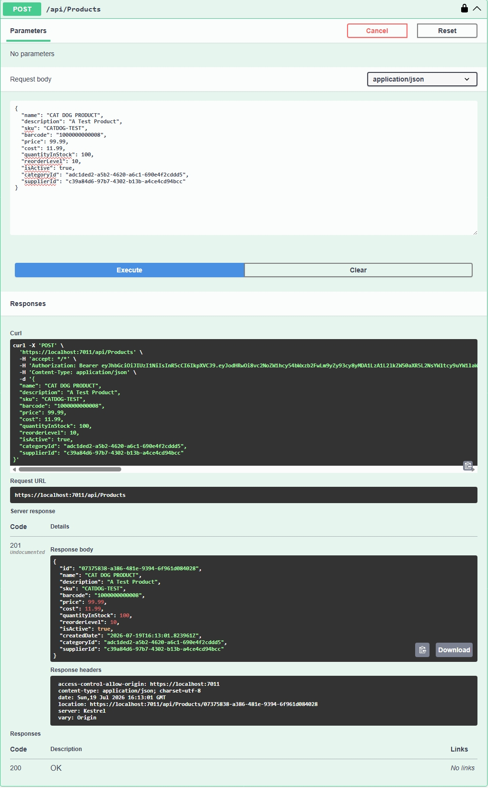 | 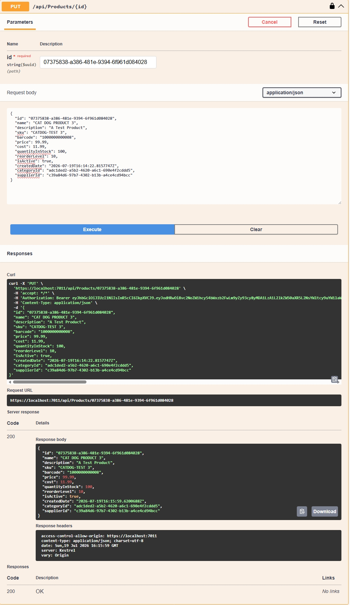 |

| Current User Profile | Role Assignment |
| :---: | :---: |
| 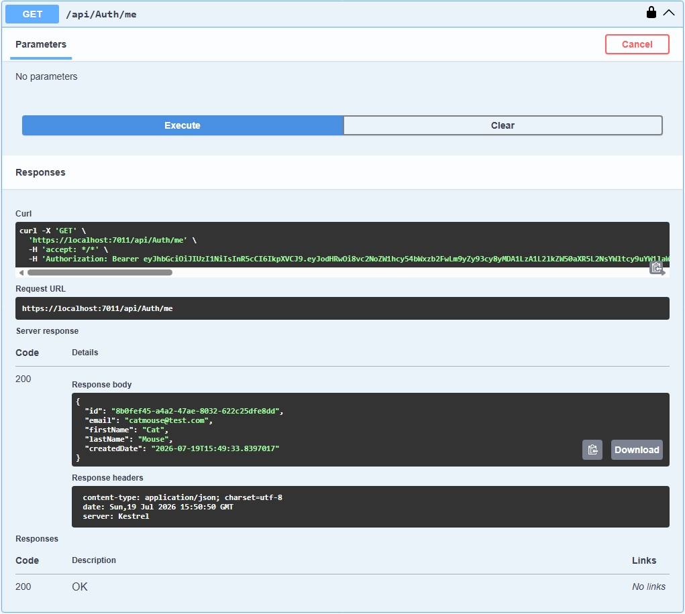 | 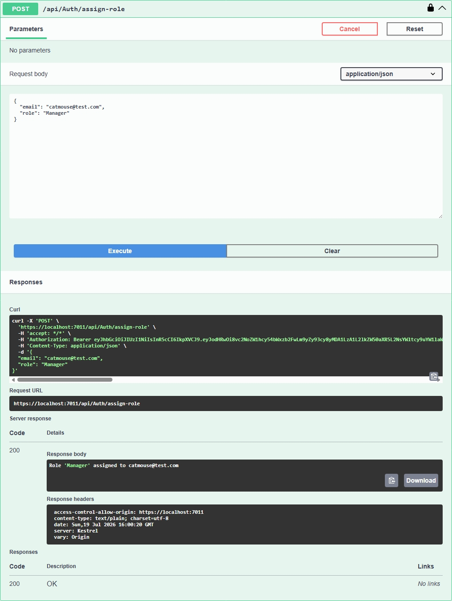 |

| Change Password | Delete Product |
| :---: | :---: |
| 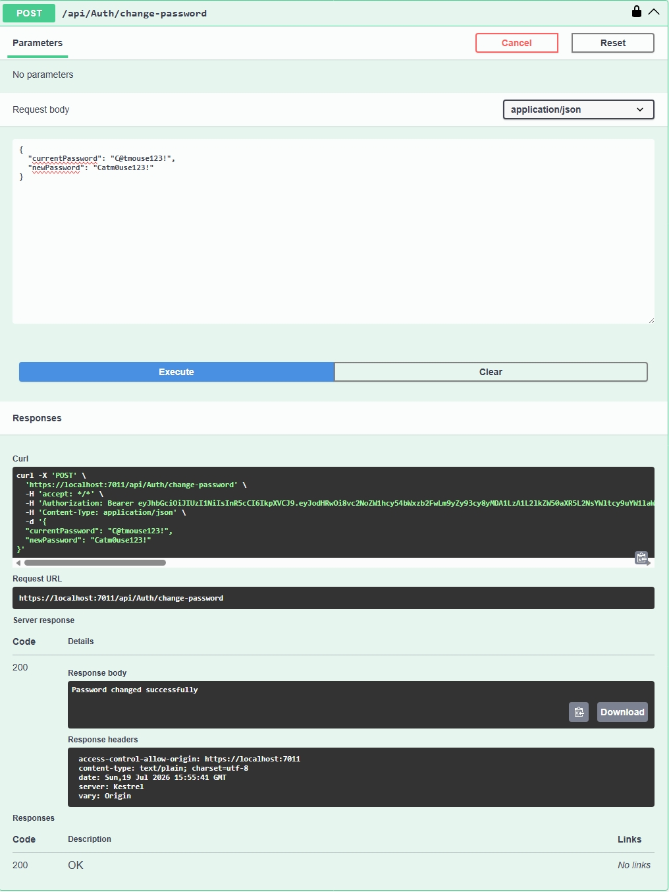 | 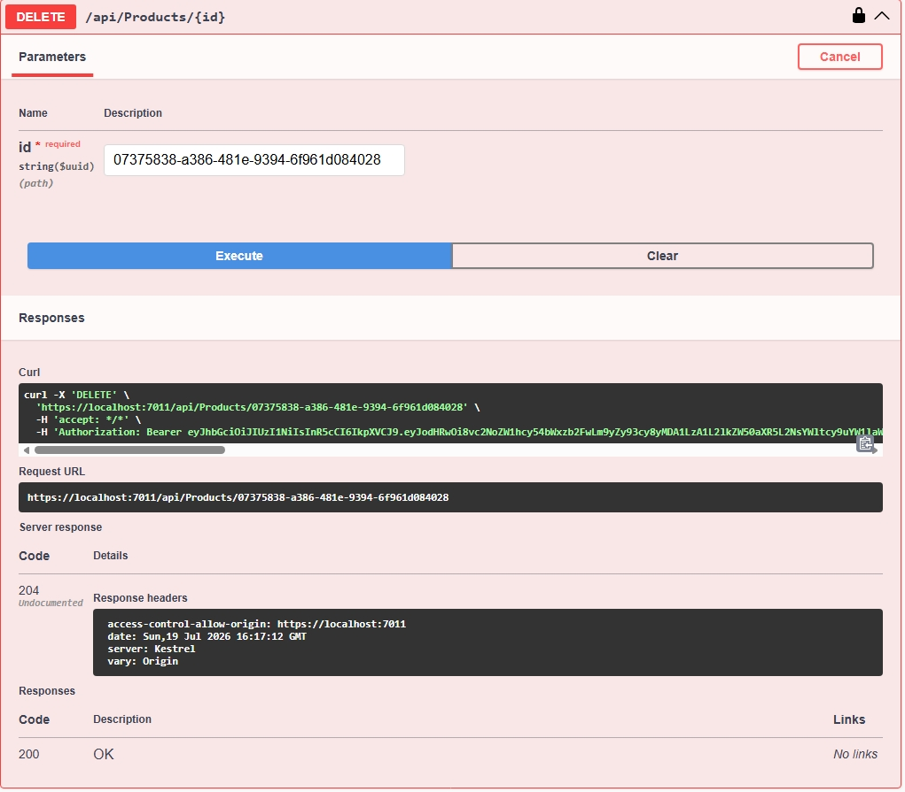 |

</details>

---

## 6. Key Features

- **Product & Catalog Management:** Full lifecycle tracking of inventory items, including SKU, unique Barcode, Category, Supplier, and Reorder Level.
- **Multi-Warehouse Stock Adjustments:** Warehouse-specific stock adjustment (`POST /api/stock/adjust` with `LocationId` or dedicated `/api/stock/locations/adjust`). Updates location quantity and total catalog quantity atomically inside an execution strategy transaction.
- **Optimistic Concurrency Protection:** SQL Server `RowVersion` concurrency tokens mapped on `Product` and `StockLevel` entities. Concurrency conflicts trigger automated retries with exponential backoff, jitter, and database entity reloads (`ReloadAsync()`).
- **Overselling & Negative Stock Prevention:** Domain checks strictly reject adjustments that would result in negative quantities at either the warehouse or catalog level (`HTTP 409 Conflict`).
- **Raw SQL Low-Stock Reporting:** High-efficiency SQL Server query (`Database.SqlQuery<LowStockReportDto>`) using `INNER JOIN`, `GROUP BY`, and a parameterized `HAVING SUM(sl.Quantity) <= @threshold` clause to prevent SQL injection.
- **AI Inventory Replenishment Advisor:** The AI Replenishment Advisor (`GET /api/Reports/low-stock/summary`) uses the `ILlmClient` abstraction to send low-stock inventory data to OpenAI's API (`gpt-4o-mini`) using structured JSON schema output enforcement, generating an executive summary and actionable reorder recommendations. In automated CI pipelines and local testing, `MockLlmClient` tests the integration deterministically without API keys, while the live `OpenAiLlmClient` is unit-tested but unverified against a funded production account. If `OPENAI_API_KEY` is unset or an upstream API error occurs, the endpoint catches the exception and returns `HTTP 503 Service Unavailable` with `{"message": "LLM summary service is currently unavailable."}`; if no products are below the threshold, it immediately returns a static message (`"All products currently meet or exceed the inventory threshold."`) without invoking the model (no algorithmic reorder calculation exists in the controller). See [`docs/ai-workflow.md`](docs/ai-workflow.md) for documentation of practical AI usage, oversight, and historical defect resolutions.
- **JWT Authentication & RBAC:** ASP.NET Core Identity integration with JWT Bearer tokens and role-based authorization across `Admin`, `Manager`, and `User` roles.
- **Request Validation:** FluentValidation rules ensuring input validation, positive prices, valid foreign key references, and duplicate prevention for SKUs and Barcodes.
- **Centralized Error Handling:** Custom middleware catching unhandled exceptions and returning standard, structured error responses.
- **Legacy MVC 5 Sidecar:** Isolated .NET Framework 4.8 / ASP.NET MVC 5 project (`legacy/StockFlow.LegacyMvc5`) complete with `Global.asax`, `Web.config`, ADO.NET data access with `UPDLOCK`, and xUnit/Moq tests to document enterprise migration.

---

## 7. Technology Stack

| Category | Technology | Details |
| :--- | :--- | :--- |
| **Backend Framework** | **ASP.NET Core 8** | Modern, cross-platform Web API & Razor MVC |
| **Programming Language** | **C# 12** | Nullable reference types, records, pattern matching |
| **Data Access & ORM** | **Entity Framework Core 8** | Code-First migrations, Fluent API, raw SQL queries |
| **Database Engine** | **Microsoft SQL Server 2022** | Relational schema, unique indexes, RowVersion tokens |
| **Authentication & Security** | **ASP.NET Core Identity & JWT** | Bearer tokens (RFC 7519), PBKDF2 password hashing |
| **Request Validation** | **FluentValidation 11.x** | Automated request pipeline validation rules |
| **AI / LLM Integration** | **OpenAI API (`gpt-4o-mini`)** | Structured JSON schema outputs, HTTP 503 fallback handling |
| **Testing Frameworks** | **xUnit, Moq, Jest, Playwright** | Unit, integration, JavaScript DOM, and E2E browser tests |
| **Containerization** | **Docker** | Official SQL Server 2022 containers for integration testing |
| **CI/CD Automation** | **GitHub Actions** | Multi-job Linux and Windows workflows |
| **Production Hosting** | **MonsterASP.NET** | Dedicated Windows IIS hosting environment |
| **Legacy Sidecar** | **.NET Framework 4.8 / MVC 5** | ASP.NET MVC 5, Web API 2, System.Web, Moq, xUnit 2.9 |

---

## 8. Architecture Overview

StockFlow utilizes a clean, layered architecture ensuring separation of concerns between HTTP transport, business logic, and data persistence.

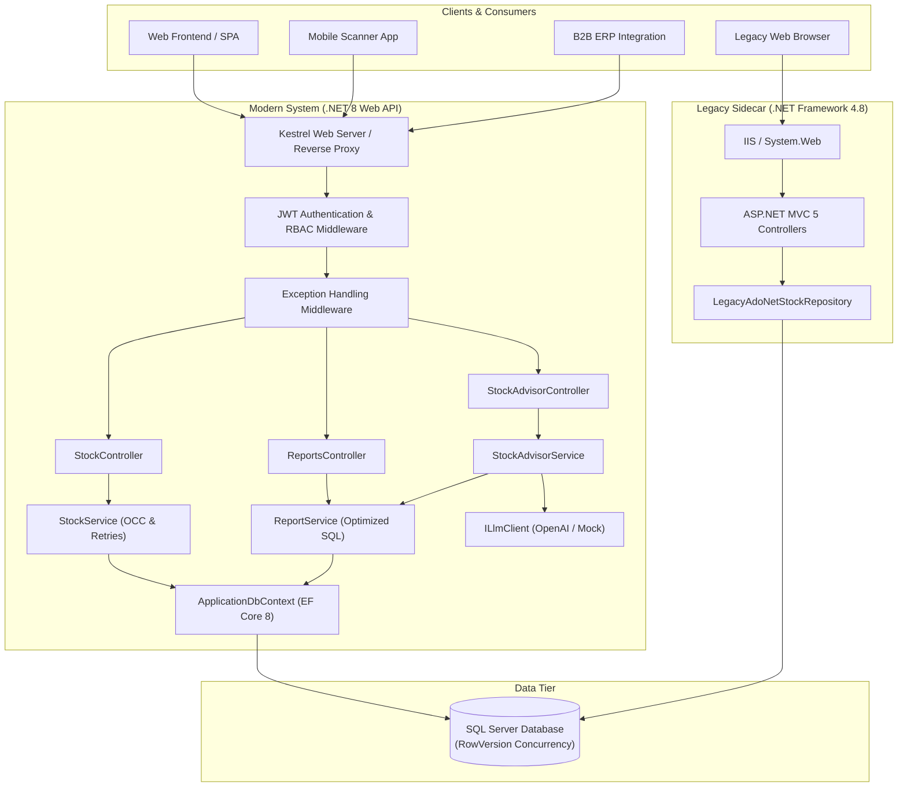

### Request Flow
1. **Middleware Pipeline:** Incoming HTTP requests pass through `ExceptionHandlingMiddleware`, validating JWT tokens and evaluating role-based claims.
2. **Controller Layer:** Routes HTTP verbs to controller actions, serializing and deserializing DTOs.
3. **Validation Layer:** FluentValidation executes automated rules before business logic execution.
4. **Service Layer:** Coordinates transactions, calculates adjustments, manages concurrency retries, and enforces negative stock rejection.
5. **Repository Layer:** Abstracted data operations utilizing EF Core 8 and raw parameterized SQL.

---

## 9. Legacy .NET Framework Sidecar

To demonstrate real-world enterprise modernization patterns and brownfield coexistence alongside the modern .NET 8 API, the repository includes a standalone .NET Framework 4.8 sidecar:

- **What It Is:** An ASP.NET MVC 5 and Web API 2 application running on .NET Framework 4.8.
- **Where It Lives:** Located in [`legacy/StockFlow.LegacyMvc5/`](legacy/StockFlow.LegacyMvc5/) with its accompanying unit test suite in [`legacy/StockFlow.LegacyMvc5.Tests/`](legacy/StockFlow.LegacyMvc5.Tests/).
- **Key Technologies Used:** Classic `Global.asax`, `Web.config`, OWIN-free ASP.NET MVC 5, and direct ADO.NET data access using `SqlConnection`, `SqlTransaction`, and SQL Server `WITH (UPDLOCK)` query hints to serialize concurrent stock updates (implemented in [`legacy/StockFlow.LegacyMvc5/Data/LegacyAdoNetStockRepository.cs`](legacy/StockFlow.LegacyMvc5/Data/LegacyAdoNetStockRepository.cs#L111)).
- **Build and Test Workflow:** Built with Windows MSBuild and tested using **xUnit 2.9** and **Moq 4.20** (10 passed, 0 failed, 1 skipped). It runs automatically on `windows-latest` GitHub Actions runners via [`.github/workflows/legacy-ci.yml`](.github/workflows/legacy-ci.yml).
- **CI Verification Evidence:** [Last successful run: #42837730376](https://github.com/Dhanya562004/stockflow-inventory-api/actions/runs/42837730376) (Conclusion: `success`, 10 passed, 0 failed, 1 skipped).
- **Production Boundary:** **This project is an isolated demonstration sidecar and is NOT deployed to production.** The live production environment runs the ASP.NET Core 8 API only.

---

## 10. Application Modules

| Module | Core Files | Responsibility |
| :--- | :--- | :--- |
| **Identity & Security** | `Controllers/Identity/AuthController.cs`<br>`Services/Implementations/TokenService.cs` | User registration, authentication, JWT creation, password changes, and role management. |
| **Product Catalog** | `Controllers/ProductsController.cs`<br>`Services/Implementations/ProductService.cs` | Product creation, updates, soft checks, SKU/Barcode unique constraint enforcement. |
| **Categories & Suppliers** | `Controllers/CategoriesController.cs`<br>`Controllers/SuppliersController.cs` | Organization of items into categories and vendor tracking with relational integrity. |
| **Procurement** | `Controllers/PurchaseOrdersController.cs`<br>`Controllers/PurchaseOrderItemsController.cs` | Purchase order tracking, cost calculations, line item management, and vendor assignments. |
| **Stock & Warehouses** | `Controllers/StockController.cs`<br>`Services/Implementations/StockService.cs`<br>`Repositories/Implementations/StockRepository.cs` | Multi-warehouse stock adjustments, optimistic concurrency retry loops, and negative stock rejection. |
| **Reporting & AI** | `Controllers/ReportsController.cs`<br>`Services/Implementations/ReportService.cs`<br>`Services/Implementations/OpenAiLlmClient.cs` | Parameterized SQL aggregation and OpenAI-powered low-stock recommendations. |
| **Legacy Sidecar** | `legacy/StockFlow.LegacyMvc5/` | Isolated .NET Framework 4.8 / ASP.NET MVC 5 application modeling pre-migration architecture. |

---

## 11. API Endpoints

Interactive documentation is available at the live Swagger URL: **[https://dhanya-stockflow.runasp.net/swagger/index.html](https://dhanya-stockflow.runasp.net/swagger/index.html)**.

### Authentication & User Management
| Method | Endpoint | Authorization | Description |
| :--- | :--- | :--- | :--- |
| `POST` | `/api/Auth/login` | Anonymous | Authenticates credentials and returns a JWT Bearer token |
| `POST` | `/api/Auth/register` | Anonymous | Registers a new user account with default `User` role |
| `GET` | `/api/Auth/me` | Authenticated | Retrieves profile details of the currently authenticated user |
| `POST` | `/api/Auth/change-password` | Authenticated | Updates the password for the current authenticated user |
| `POST` | `/api/Auth/assign-role` | `Admin` | Assigns an authorization role (`Admin`, `Manager`, `User`) to an account |

### Product Catalog
| Method | Endpoint | Authorization | Description |
| :--- | :--- | :--- | :--- |
| `GET` | `/api/Products` | Anonymous | Lists all products in the catalog (public catalog access) |
| `GET` | `/api/Products/{id}` | Authenticated | Retrieves detailed information for a specific product ID |
| `POST` | `/api/Products` | `Admin, Manager` | Creates a new product record with SKU and barcode validation |
| `PUT` | `/api/Products/{id}` | `Admin, Manager` | Modifies an existing product's details and metadata |
| `DELETE` | `/api/Products/{id}` | `Admin` | Deletes a product record from the catalog |

### Categories & Suppliers
| Method | Endpoint | Authorization | Description |
| :--- | :--- | :--- | :--- |
| `GET` | `/api/Categories` | Authenticated | Lists all product categories |
| `GET` | `/api/Categories/{id}` | Authenticated | Retrieves category details by ID |
| `POST` | `/api/Categories` | `Admin, Manager` | Creates a new category |
| `PUT` | `/api/Categories/{id}` | `Admin, Manager` | Updates an existing category |
| `DELETE` | `/api/Categories/{id}` | `Admin` | Deletes a category |
| `GET` | `/api/Suppliers` | Authenticated | Lists all registered suppliers |
| `GET` | `/api/Suppliers/{id}` | Authenticated | Retrieves supplier details by ID |
| `POST` | `/api/Suppliers` | `Admin, Manager` | Registers a new supplier |
| `PUT` | `/api/Suppliers/{id}` | `Admin, Manager` | Updates supplier information |
| `DELETE` | `/api/Suppliers/{id}` | `Admin` | Deletes a supplier record |

### Procurement & Purchase Orders
| Method | Endpoint | Authorization | Description |
| :--- | :--- | :--- | :--- |
| `GET` | `/api/PurchaseOrders` | Authenticated | Lists all purchase orders with order totals |
| `GET` | `/api/PurchaseOrders/{id}` | Authenticated | Retrieves purchase order details by ID |
| `POST` | `/api/PurchaseOrders` | `Admin, Manager` | Creates a new purchase order |
| `PUT` | `/api/PurchaseOrders/{id}` | `Admin, Manager` | Updates purchase order details |
| `DELETE` | `/api/PurchaseOrders/{id}` | `Admin` | Deletes a purchase order |
| `GET` | `/api/PurchaseOrderItems` | Authenticated | Lists purchase order line items |
| `POST` | `/api/PurchaseOrderItems` | `Admin, Manager` | Adds a line item to a purchase order |
| `PUT` | `/api/PurchaseOrderItems/{id}` | `Admin, Manager` | Updates a purchase order line item |
| `DELETE` | `/api/PurchaseOrderItems/{id}` | `Admin` | Removes a line item from a purchase order |

### Inventory, Reporting & Health
| Method | Endpoint | Authorization | Description |
| :--- | :--- | :--- | :--- |
| `POST` | `/api/Stock/adjust` | `Admin, Manager` | Adjusts catalog or warehouse stock (`{ productId, locationId?, delta }`) |
| `POST` | `/api/Stock/locations/adjust` | `Admin, Manager` | Dedicated endpoint for warehouse-specific stock adjustment |
| `GET` | `/api/Reports/low-stock` | Authenticated | Raw parameterized SQL report listing items at or below threshold |
| `GET` | `/api/Reports/low-stock/summary` | Authenticated | AI-assisted executive replenishment analysis via OpenAI |
| `GET` | `/stock` | Anonymous | Razor MVC interactive stock adjustment and AI dashboard |
| `GET` | `/health` | Anonymous | Production health check returning service operational status |

---

## 12. Authentication and Authorization

### Authentication
Authentication is handled via **ASP.NET Core Identity** and **JWT Bearer Tokens**:
- Passwords are securely hashed using PBKDF2 with HMAC-SHA256.
- The `/api/Auth/login` endpoint validates credentials and emits an RFC 7519 JWT token signed with a 256-bit secret key.
- Tokens carry standard claims: `NameIdentifier`, `Email`, `Jti`, and `Role`.

### Role-Based Authorization
Controllers and actions enforce declarative role-based access control (RBAC):
- `Admin`: Full access, including account role management and entity deletion.
- `Manager`: Elevated operational access to create and edit catalog items, purchase orders, and suppliers.
- `User`: Standard authenticated access to query protected resources.

```csharp
[Authorize(Roles = "Admin")]
[HttpDelete("{id}")]
public async Task<IActionResult> Delete(Guid id) { ... }
```

---

## 13. Database Design

The relational schema is configured in `Data/AppDbContext.cs` and managed through Entity Framework Core migrations.

```
┌──────────────┐          ┌──────────────┐          ┌────────────────────┐
│  Categories  │ 1      * │   Products   │ 1      * │ PurchaseOrderItems │
│──────────────│──────────│──────────────│──────────│────────────────────│
│ Id (PK)      │          │ Id (PK)      │          │ Id (PK)            │
│ Name         │          │ Name         │          │ PurchaseOrderId(FK)│
└──────────────┘          │ SKU (UQ)     │          │ ProductId (FK)     │
                          │ Barcode (UQ) │          │ Quantity           │
┌──────────────┐ 1      * │ CategoryId   │          │ Cost               │
│  Suppliers   │──────────│ SupplierId   │          └────────────────────┘
│──────────────│          │ RowVersion   │                     *
│ Id (PK)      │          └──────────────┘                     │ 1
│ CompanyName  │                 1 │                           │
└──────────────┘                   │               ┌────────────────────┐
       │ 1                         │ *             │   PurchaseOrders   │
       │                           ▼               │────────────────────│
       │ *                ┌──────────────┐         │ Id (PK)            │
       └─────────────────▶│ StockLevels  │         │ OrderNumber (UQ)   │
                          │──────────────│         │ SupplierId (FK)    │
                          │ Id (PK)      │         │ OrderDate          │
                          │ ProductId(FK)│         │ TotalAmount        │
                          │ LocationId   │         └────────────────────┘
                          │ Quantity     │
                          │ RowVersion   │
                          └──────────────┘
```

### Relational Constraints and Indexes
- **Unique Indexes:**
  - `IX_Products_SKU` on `Products(SKU)`
  - `IX_Products_Barcode` on `Products(Barcode)`
  - `IX_PurchaseOrders_OrderNumber` on `PurchaseOrders(OrderNumber)`
  - `IX_StockLevels_ProductId_LocationId_Unique` on `StockLevels(ProductId, LocationId)`
- **Concurrency Tokens:** `RowVersion` columns on `Products` and `StockLevels` are mapped with `.IsRowVersion()` to generate SQL Server `rowversion` timestamps.

### Low-Stock Raw SQL Aggregation
```sql
SELECT 
    p.Id AS ProductId,
    p.Name AS ProductName,
    p.SKU AS SKU,
    CAST(SUM(sl.Quantity) AS INT) AS CurrentStock,
    p.ReorderLevel AS ReorderLevel
FROM StockLevels sl
INNER JOIN Products p ON sl.ProductId = p.Id
GROUP BY p.Id, p.Name, p.SKU, p.ReorderLevel
HAVING SUM(sl.Quantity) <= @threshold
ORDER BY CurrentStock ASC
```

---

## 14. Installation and Local Setup

### Prerequisites
- [.NET 8.0 SDK](https://dotnet.microsoft.com/download/dotnet/8.0)
- [Microsoft SQL Server](https://www.microsoft.com/sql-server) or [Docker Desktop](https://www.docker.com/)
- [Node.js 20+](https://nodejs.org/) (for frontend JavaScript tests)
- [Git](https://git-scm.com/)

### Step-by-Step Setup

1. **Clone the repository:**
   ```bash
   git clone https://github.com/Dhanya562004/stockflow-inventory-api.git
   cd stockflow-inventory-api
   ```

2. **Restore .NET dependencies:**
   ```bash
   dotnet restore InventoryManagementSystemAPI.sln
   ```

3. **Install JavaScript test dependencies:**
   ```bash
   cd tests/js
   npm install
   cd ../..
   ```

4. **Start local SQL Server (via Docker):**
   ```bash
   docker run -e "ACCEPT_EULA=Y" -e "MSSQL_SA_PASSWORD=<your-sa-password>" \
      -p 1433:1433 --name stockflow-sql -d \
      mcr.microsoft.com/mssql/server:2022-latest
   ```

5. **Apply database migrations & seed initial data:**
   ```bash
   dotnet ef database update
   ```

---

## 15. Environment Variables and Configuration

Application configuration is read from `appsettings.json` and overridden by environment variables:

```json
{
  "ConnectionStrings": {
    "DefaultConnection": "Server=localhost,1433;Database=InventoryDB;User Id=sa;Password=<your-sa-password>;TrustServerCertificate=True;MultipleActiveResultSets=True;"
  },
  "Jwt": {
    "Key": "<your-jwt-key>",
    "Issuer": "InventoryManagementSystemAPI",
    "Audience": "InventoryManagementSystemClient"
  },
  "OpenAI": {
    "ApiKey": "<your-openai-key>",
    "Model": "gpt-4o-mini"
  }
}
```

### Environment Overrides (Production)
In production (MonsterASP.NET), sensitive values are injected through environment variables without committing credentials to source control (see `docs/deploy-azure.md` for doc-only Azure blueprint):
- `ConnectionStrings__DefaultConnection`: Target SQL Server connection string
- `Jwt__Key`: 256-bit cryptographically secure secret
- `OpenAI__ApiKey`: OpenAI API secret key for the AI replenishment advisor (optional; returns HTTP 503 if omitted or upstream call fails)
- `SQL_SERVER_TEST_CONNECTION_STRING`: Connection string used by automated integration test containers

---

## 16. Running the Application

### Start the .NET 8 Web API
```bash
dotnet run --launch-profile https
```

Once running, access the local endpoints:
- **Swagger UI:** `https://localhost:7011/swagger` or `http://localhost:5228/swagger`
- **Stock Adjustment & AI Advisor UI:** `https://localhost:7011/stock`
- **Health Endpoint:** `https://localhost:7011/health`

### Run the Isolated Legacy MVC 5 Project (Windows only)
```bash
dotnet build legacy/StockFlow.Legacy.sln
dotnet test legacy/StockFlow.Legacy.sln
```

---

## 17. Testing and Test Results

The repository features comprehensive automated test suites covering unit logic, database transactions, concurrency conflicts, and frontend DOM behaviors.

### Verified Test Results

| Test Suite | Environment | Framework | Passed | Failed | Skipped | Total | Scope / Verification Focus |
| :--- | :--- | :--- | :---: | :---: | :---: | :---: | :--- |
| **.NET 8 Test Suite** | CI run | xUnit 2.8 / Moq 4.20 | **46** | **0** | **2** | **48** | Unit tests, service logic, DTO validators, and 14 SQL Server integration tests |
| **Legacy .NET Framework Tests** | CI run | xUnit 2.9 / Moq 4.20 | **10** | **0** | **1** | **11** | ASP.NET MVC 5 and Web API 2 controller actions, ADO.NET repository with `UPDLOCK` |
| **Frontend JavaScript Tests** | Local run | Jest 29 / jsdom | **12** | **0** | **0** | **12** | Client-side DOM manipulation (`stock.js`), error UI states (400, 404, 409, 500), and XSS prevention |

*(Note: Browser end-to-end tests are maintained in `tests/js/e2e/stock.spec.js` and run in CI via Playwright).*

### Explanation of Skipped Tests
In automated CI runs, only 3 tests are skipped because they require external secrets not configured in CI:
- **2 Live AI/LLM Tests:** Located in `LiveLlmClientTests.cs` and `LowStockEvaluationTests.cs`. Both tests check for `LLM_API_KEY` via `[SkippableFact]` and skip when an API key is not configured or live evaluation is disabled, avoiding external API calls in CI.
- **1 Legacy SQL Server Test:** Located in `legacy/StockFlow.LegacyMvc5.Tests/Data/LegacyAdoNetStockRepositoryRealSqlTests.cs`. Exercises raw ADO.NET updates against real SQL Server; skipped via `[SkippableFact]` because `SQL_SERVER_TEST_CONNECTION_STRING` is not configured in the legacy Windows CI runner.

All 14 SQL Server integration tests run and pass in CI against the SQL Server container.

### Running Tests Locally

```bash
# 1. Run all core .NET 8 unit and service tests
dotnet test InventoryManagementSystemAPI.sln

# 2. Run with code coverage collection
dotnet test --collect:"XPlat Code Coverage" --results-directory ./TestResults

# 3. Run frontend JavaScript tests
npm test --prefix tests/js

# 4. Run SQL Server integration tests (requires local SQL container)
$env:SQL_SERVER_TEST_CONNECTION_STRING="Server=127.0.0.1,1433;Database=InventoryTestDB;User Id=sa;Password=<your-sa-password>;TrustServerCertificate=True;"
dotnet test --filter "FullyQualifiedName~StockEndpointIntegrationTests"

# 5. Run legacy MVC 5 tests (.NET Framework 4.8 on Windows)
dotnet test legacy/StockFlow.Legacy.sln
```

---

## 18. CI/CD Pipeline

Continuous Integration is automated using **GitHub Actions**:

- **Modern Pipeline ([`.github/workflows/ci.yml`](.github/workflows/ci.yml)):**
  - **Runner:** Ubuntu Latest
  - **Service Container:** Microsoft SQL Server 2022 container
  - **Steps:** Dependency restoration, .NET compilation, SQL Server integration test execution, Coverlet code coverage enforcement (7.0% threshold), Jest JavaScript test execution, and Playwright Chromium browser tests.
- **Legacy Pipeline ([`.github/workflows/legacy-ci.yml`](.github/workflows/legacy-ci.yml)):**
  - **Runner:** Windows Latest
  - **Status:** [Last successful run: #42837730376](https://github.com/Dhanya562004/stockflow-inventory-api/actions/runs/42837730376) (Conclusion: `success`)
  - **Steps:** MSBuild restoration and compilation of `.NET Framework 4.8` assemblies, running Moq unit tests in `StockFlow.LegacyMvc5.Tests`.

---

## 19. Deployment

The application is deployed on **MonsterASP.NET** (Windows Server IIS cloud hosting).

### Production Configuration
- **Runtime:** .NET 8.0 CLR running in out-of-process hosting mode behind IIS.
- **Database:** Hosted Microsoft SQL Server instance with connection strings injected via platform configuration.
- **HTTPS Redirect Note:** Automatic HTTP-to-HTTPS redirect has not been independently verified under all custom host configurations; clients should use `https://` directly.
- **Swagger Documentation:** Enabled in production for public demonstration and API exploration.

### Architectural Migration Whitepapers
For teams evaluating cloud transitions, this repository includes in-depth engineering documentation in `docs/`:
- **[System Architecture](docs/architecture.md):** Detailed component diagrams, request flows, and ER diagrams.
- **[Design Decisions (ADRs)](docs/design-decisions.md):** 6 Architectural Decision Records on concurrency, reporting, and AI.
- **[AI Workflow & Case Studies](docs/ai-workflow.md):** AI-assisted development protocols and historical defect resolutions.
- **[Legacy Migration Guide](docs/dotnet-framework-to-dotnet8-migration.md):** Strangler Fig migration strategy from ASP.NET MVC 5 to ASP.NET Core 8 with YARP.
- **[Multi-Channel Concurrency](docs/cin7-multi-channel-inventory.md):** Race condition mitigation and RowVersion tokens for retail inventory synchronization.
- **[SQL Server Indexing Strategy](docs/sql-server-indexing-and-performance.md):** Index analysis, covered queries, and RCSI configuration.
- **[Azure Deployment Blueprint](docs/deploy-azure.md):** Architectural blueprint for Azure App Service and Azure SQL. *(Note: Documented for enterprise reference only; Azure is not an active deployment target for this project).*

---

## 20. Project Structure

```text
stockflow-inventory-api/
├── .github/
│   ├── ISSUE_TEMPLATE/
│   │   ├── bug_report.md                      # Bug report submission template
│   │   └── feature_request.md                 # Feature request template
│   ├── workflows/
│   │   ├── ci.yml                             # Primary Linux CI workflow (.NET 8 + SQL Server container)
│   │   └── legacy-ci.yml                      # Windows CI workflow (.NET Framework 4.8)
│   ├── dependabot.yml                         # Automated dependency updates
│   └── pull_request_template.md               # Structured PR checklist template
├── Configurations/                            # Identity, Swagger, and DI configuration classes
├── Controllers/                               # ASP.NET Core 8 API Controllers
│   ├── Identity/                              # AuthController (Login, Register, Roles)
│   ├── CategoriesController.cs
│   ├── ProductsController.cs
│   ├── PurchaseOrdersController.cs
│   ├── PurchaseOrderItemsController.cs
│   ├── ReportsController.cs                   # Low-stock SQL & AI replenishment endpoints
│   ├── StockController.cs                     # Stock adjustment & Razor view routing
│   └── SuppliersController.cs
├── Data/                                      # EF Core AppDbContext and Seed data
│   ├── AppDbContext.cs                        # Entity configurations, keys, and rowversion tokens
│   └── Seed/                                  # AppDataSeeder & IdentityDataSeeder
├── docs/                                      # Architecture, ADRs, whitepapers, and screenshots
│   ├── images/                                # Verified Swagger/Postman interface captures
│   ├── ai-workflow.md                         # AI pairing case studies and verification logs
│   ├── architecture.md                        # Mermaid component architecture and sequence flows
│   ├── cin7-multi-channel-inventory.md        # Concurrency and inventory whitepaper
│   ├── code-review-checklist.md               # Engineering code review guidelines
│   ├── deploy-azure.md                        # Azure reference deployment blueprint
│   ├── design-decisions.md                    # 6 Architectural Decision Records (ADRs)
│   ├── dotnet-framework-to-dotnet8-migration.md
│   └── sql-server-indexing-and-performance.md
├── DTOs/                                      # Data Transfer Objects organized by domain
├── Exceptions/                                # InsufficientStockException & NotFoundException
├── legacy/                                    # Isolated .NET Framework 4.8 / MVC 5 project
│   ├── StockFlow.Legacy.sln
│   ├── StockFlow.LegacyMvc5/                  # Global.asax, Web.config, MVC 5 controllers
│   └── StockFlow.LegacyMvc5.Tests/            # xUnit / Moq test project (net48)
├── Middleware/                                # Centralized ExceptionHandlingMiddleware
├── Models/                                    # EF Core domain entities (Product, StockLevel, etc.)
├── Repositories/                              # Repository interfaces and EF Core implementations
│   ├── Implementations/                       # StockRepository, ProductRepository, etc.
│   └── Interfaces/                            # IStockRepository, IProductRepository, etc.
├── Services/                                  # Business logic implementations and contracts
│   ├── Implementations/                       # StockService, OpenAiLlmClient, ReportService, etc.
│   └── Interfaces/                            # IStockService, ILlmClient, IReportService, etc.
├── Validators/                                # FluentValidation classes for DTOs
├── Views/Stock/Index.cshtml                   # Razor MVC view for stock adjustment and AI analysis
├── wwwroot/                                   # Client-side JavaScript (stock.js) and CSS (stock.css)
├── InventoryManagementSystemAPI.Tests/        # xUnit test suite (Unit, Integration, Fakes)
└── tests/js/                                  # Jest frontend tests and Playwright browser specs
```

---

## 21. Architectural Decision Records (ADRs)

Key architectural decisions, context, trade-offs, and rejected alternatives are formally documented in [`docs/design-decisions.md`](docs/design-decisions.md):

- [ADR-001: Optimistic Concurrency via RowVersion vs. Pessimistic Locking](docs/design-decisions.md#adr-001-optimistic-concurrency-via-rowversion-vs-pessimistic-locking)
- [ADR-002: Parameterized Raw SQL for Low-Stock Aggregation Reporting](docs/design-decisions.md#adr-002-parameterized-raw-sql-for-low-stock-aggregation-reporting)
- [ADR-003: ILlmClient Abstraction for AI Replenishment Advisor](docs/design-decisions.md#adr-003-illmclient-abstraction-for-ai-replenishment-advisor)
- [ADR-004: Isolated Legacy .NET Framework 4.8 / ASP.NET MVC 5 Sidecar](docs/design-decisions.md#adr-004-isolated-legacy-net-framework-48--aspnet-mvc-5-sidecar)
- [ADR-005: Multi-Warehouse Inventory Model with Catalog Totals Synchronization](docs/design-decisions.md#adr-005-multi-warehouse-inventory-model-with-catalog-totals-synchronization)
- [ADR-006: HTTP 409 Conflict for Negative Stock Prevention](docs/design-decisions.md#adr-006-http-409-conflict-for-negative-stock-prevention)

---

## 22. Engineering Process and Quality Standards

All changes to StockFlow adhere to rigorous software engineering and quality assurance practices:

- **Pull Request Template:** Submissions follow [`.github/pull_request_template.md`](.github/pull_request_template.md), requiring problem statements, verification evidence, and security/concurrency checklists.
- **Code Review Checklist:** Code reviews follow [`docs/code-review-checklist.md`](docs/code-review-checklist.md) *(located in `docs/`)*, auditing authorization attributes, input boundaries, atomic multi-entity transactions, safe SQL parameterization, and semantic error codes.
- **Issue Templates:** Defects and enhancements are tracked via [Bug Report](.github/ISSUE_TEMPLATE/bug_report.md) and [Feature Request](.github/ISSUE_TEMPLATE/feature_request.md) templates.
- **Conventional Commits:** Standardized prefixing (`feat:`, `fix:`, `docs:`, `test:`, `perf:`) is used across all pull requests to ensure a readable git history.
- **Code Review Evidence:** [Pull Request #21](https://github.com/Dhanya562004/stockflow-inventory-api/pull/21) illustrates our peer review process, multi-commit evolution, and verification evidence across security, legacy, testing, and architecture.
- **Branch Protection:** Not configured on GitHub repository (no branch protection rules currently active).
- **Project Board:** No project board is currently linked in this repository.

---

## 23. Known Limitations

To maintain engineering transparency, the following operational and environment constraints are documented:

1. **Shared Cloud Hosting Tier:** The live demo is hosted on MonsterASP.NET shared Windows IIS hosting. Cold starts (idle process recycling) may cause an initial latency spike of 5–10 seconds on the first request.
2. **Live AI Integration is Mock-Tested:** The `OpenAiLlmClient` implementation uses standard OpenAI API JSON schema completion. Automated CI and unit test suites utilize `MockLlmClient` and synthetic test fixtures. Live calls to OpenAI endpoints require configuring an active, funded `OPENAI_API_KEY` in environment variables.
3. **Default Seeded Credentials:** In development and test environments, `IdentityDataSeeder` provisions a default admin account (`admin@stockflow.local`). In an enterprise production rollout, this seeder must be disabled or the credentials rotated immediately upon deployment.
4. **Code Coverage Baseline:** Code coverage is actively measured via Coverlet and enforced at a **7.0% minimum gate** in the GitHub Actions CI pipeline, focusing heavily on core domain logic, validators, and concurrency execution paths.
5. **Legacy CI Platform Dependency:** The legacy .NET Framework 4.8 sidecar (`legacy/StockFlow.LegacyMvc5`) relies on `System.Web` and MSBuild, requiring Windows-based runners (`windows-latest` in `.github/workflows/legacy-ci.yml`), whereas the modern .NET 8 API builds cross-platform on Ubuntu Linux.
6. **HTTPS Redirect Behavior:** Automated HTTP-to-HTTPS redirect rules depend on shared IIS URL rewrite modules and have not been independently verified under all custom domain headers; callers should use `https://dhanya-stockflow.runasp.net` explicitly.

---

## 24. Future Improvements

- **Multi-Tenancy Partitioning:** Add a `TenantId` discriminator column with EF Core Global Query Filters for multi-organization SaaS isolation.
- **Structured Centralized Logging:** Integrate Serilog with Seq or OpenTelemetry for structured distributed tracing.
- **Distributed Caching:** Add Redis caching for frequently queried public catalog endpoints (`/api/Products`).
- **Modern Single-Page Application (SPA):** Build a standalone React/Next.js dashboard to consume the REST API alongside the existing Razor interface.
- **Automated Reorder Webhooks:** Outbound webhooks dispatched to suppliers when stock levels breach reorder thresholds.

---

## 25. License and Project Attribution

**StockFlow** is developed and maintained by **Dhanya K.** ([github.com/Dhanya562004](https://github.com/Dhanya562004)). Significant enterprise enhancements, multi-warehouse transactions, concurrency controls, SQL optimizations, AI integrations, test automation, and legacy sidecar modernization were engineered in this repository.

This project is distributed under the terms of the [MIT License](LICENSE).
