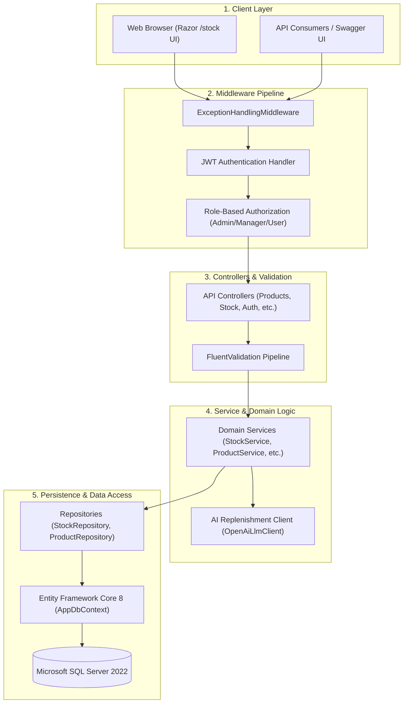

<div align="center">

# StockFlow — Inventory Management System API

<p align="center">
  <strong>A production-inspired, multi-warehouse SaaS Inventory Management REST API and Razor MVC Application built with ASP.NET Core 8, Entity Framework Core, SQL Server, and AI-assisted inventory replenishment insights.</strong>
</p>

[](https://github.com/Dhanya562004/stockflow-inventory-api/actions/workflows/ci.yml)
[](https://dotnet.microsoft.com/)
[](https://learn.microsoft.com/dotnet/csharp/)
[](https://dotnet.microsoft.com/apps/aspnet)
[](https://learn.microsoft.com/ef/core/)
[](https://www.microsoft.com/sql-server)
[](https://jwt.io/)
[](https://fluentvalidation.net/)
[](https://xunit.net/)
[](https://dhanya-stockflow.runasp.net/)

<p align="center">
  <a href="https://dhanya-stockflow.runasp.net/"><strong>🌐 Live Application</strong></a> •
  <a href="https://dhanya-stockflow.runasp.net/swagger/index.html"><strong>📖 Swagger API Documentation</strong></a> •
  <a href="https://dhanya-stockflow.runasp.net/health"><strong>🩺 Production Health Check</strong></a> •
  <a href="https://github.com/Dhanya562004/stockflow-inventory-api"><strong>💻 GitHub Repository</strong></a> •
  <a href="https://github.com/Dhanya562004/stockflow-inventory-api/actions"><strong>🚀 GitHub Actions</strong></a>
</p>

</div>

> [!NOTE]
> **Project Acknowledgements & Attribution:** This repository is based on the open-source foundation created by **Michael Mitchell** ([github.com/mmitchell3397/IMS-WebAPI](https://github.com/mmitchell3397/IMS-WebAPI)). **Dhanya K** ([github.com/Dhanya562004](https://github.com/Dhanya562004)) developed significant extensions, including multi-warehouse inventory tracking, atomic dual-entity database transactions, row-version optimistic concurrency handling, raw SQL aggregation reports, an AI Replenishment Advisor calling LLM APIs, an isolated .NET Framework 4.8 / ASP.NET MVC 5 legacy sidecar, automated SQL Server container integration tests, and multi-stage CI/CD workflows.

---

## Table of Contents

- [1. Project Overview](#1-project-overview)
- [2. Live Demo and Useful Links](#2-live-demo-and-useful-links)
- [3. Screenshots](#3-screenshots)
- [4. Key Features](#4-key-features)
- [5. Technology Stack](#5-technology-stack)
- [6. Architecture Overview](#6-architecture-overview)
- [7. Application Modules](#7-application-modules)
- [8. API Endpoints](#8-api-endpoints)
- [9. Authentication and Authorization](#9-authentication-and-authorization)
- [10. Database Design](#10-database-design)
- [11. Installation and Local Setup](#11-installation-and-local-setup)
- [12. Environment Variables and Configuration](#12-environment-variables-and-configuration)
- [13. Running the Application](#13-running-the-application)
- [14. Testing and Test Results](#14-testing-and-test-results)
- [15. CI/CD Pipeline](#15-cicd-pipeline)
- [16. Deployment](#16-deployment)
- [17. Project Structure](#17-project-structure)
- [18. Future Improvements](#18-future-improvements)
- [19. Acknowledgements](#19-acknowledgements)

---

## 1. Project Overview

**StockFlow** is a backend-focused Inventory Management System engineered to demonstrate modern, enterprise-grade software development practices within the **ASP.NET Core 8** ecosystem.

Managing inventory at scale requires strict data consistency across sales channels, multi-location storage facilities, and high-frequency order processing. StockFlow addresses these engineering challenges with:

- **Multi-Warehouse Stock Isolation:** Independent stock tracking per location (`WH-MAIN`, `WH-SECONDARY`) with atomic catalog total synchronization.
- **Concurrency & Double-Selling Prevention:** RowVersion optimistic concurrency tokens and database execution strategy transactions that eliminate race conditions and overselling.
- **Reporting & Business Intelligence:** Parameterized raw SQL queries for performant aggregation across multi-location records without SQL injection risk.
- **AI Inventory Replenishment Advisor:** Automated stock analysis utilizing large language models (LLMs) to synthesize stock thresholds into actionable purchasing guidance.
- **Legacy Modernization Benchmark:** A buildable, isolated **.NET Framework 4.8 / ASP.NET MVC 5** sidecar project modeling the architecture and testing patterns of systems undergoing cloud migration.

---

## 2. Live Demo and Useful Links

The application is deployed and actively running on a production Windows Server IIS environment.

| Resource | URL | Status / Verification Note |
| :--- | :--- | :--- |
| **Live Web Interface** | [dhanya-stockflow.runasp.net](https://dhanya-stockflow.runasp.net/) | HTTP 200 — Stock adjustment & AI advisor page |
| **Swagger API Explorer** | [dhanya-stockflow.runasp.net/swagger/index.html](https://dhanya-stockflow.runasp.net/swagger/index.html) | HTTP 200 — Interactive OpenAPI documentation |
| **Production Health Check** | [dhanya-stockflow.runasp.net/health](https://dhanya-stockflow.runasp.net/health) | HTTP 200 — Returns `{"status":"Healthy"}` |
| **GitHub Repository** | [github.com/Dhanya562004/stockflow-inventory-api](https://github.com/Dhanya562004/stockflow-inventory-api) | Main codebase and issue tracker |
| **GitHub Actions CI/CD** | [github.com/Dhanya562004/stockflow-inventory-api/actions](https://github.com/Dhanya562004/stockflow-inventory-api/actions) | Automated test, build, and coverage runs |

### Production Verification (Conducted November 10, 2026)
- **Root Web Page (`/stock`):** Returned HTTP 200 with dynamic catalog rendering.
- **Swagger Documentation (`/swagger`):** Returned HTTP 200 with complete schema listings.
- **Health Check (`/health`):** Returned HTTP 200 with status `Healthy`.
- **Public Products Endpoint (`GET /api/Products`):** Returned HTTP 200 with seeded inventory records.
- **Low-Stock Report (`GET /api/Reports/low-stock`):** Returned HTTP 200 with aggregated database counts.
- **Protected Endpoints (`Categories`, `Suppliers`):** Returned HTTP 401 Unauthorized when accessed without a JWT Bearer token, confirming RBAC enforcement.

---

## 3. Screenshots

<details>
<summary><strong>View Application Screenshots (Authentication, Products, and Roles)</strong></summary>
<br />

| User Login | User Registration |
| :---: | :---: |
|  |  |

| Get All Products | Get Product by ID |
| :---: | :---: |
|  |  |

| Create Product | Update Product |
| :---: | :---: |
|  |  |

| Current User Profile | Role Assignment |
| :---: | :---: |
|  |  |

| Change Password | Delete Product |
| :---: | :---: |
|  |  |

</details>

---

## 4. Key Features

- **Product & Catalog Management:** Full lifecycle tracking of inventory items, including SKU, unique Barcode, Category, Supplier, and Reorder Level.
- **Multi-Warehouse Stock Adjustments:** Warehouse-specific stock adjustment (`POST /api/stock/adjust` with `LocationId` or dedicated `/api/stock/locations/adjust`). Updates location quantity and total catalog quantity atomically inside an execution strategy transaction.
- **Optimistic Concurrency Protection:** SQL Server `RowVersion` concurrency tokens mapped on `Product` and `StockLevel` entities. Concurrency conflicts trigger automated retries with exponential backoff, jitter, and database entity reloads (`ReloadAsync()`).
- **Overselling & Negative Stock Prevention:** Domain checks strictly reject adjustments that would result in negative quantities at either the warehouse or catalog level (`HTTP 409 Conflict`).
- **Raw SQL Low-Stock Reporting:** High-efficiency SQL Server query (`Database.SqlQuery<LowStockReportDto>`) using `INNER JOIN`, `GROUP BY`, and a parameterized `HAVING SUM(sl.Quantity) <= @threshold` clause to prevent SQL injection.
- **AI Inventory Replenishment Advisor:** Service layer abstraction (`ILlmClient`) that sends low-stock items to OpenAI's GPT API with structured JSON output enforcement, generating executive summaries and actionable restocking suggestions.
- **JWT Authentication & RBAC:** ASP.NET Core Identity integration with JWT Bearer tokens and role-based authorization across `Admin`, `Manager`, and `User` roles.
- **Request Validation:** FluentValidation rules ensuring input validation, positive prices, valid foreign key references, and duplicate prevention for SKUs and Barcodes.
- **Centralized Error Handling:** Custom middleware catching unhandled exceptions and returning standard, structured error responses.
- **Legacy MVC 5 Sidecar:** Isolated .NET Framework 4.8 / ASP.NET MVC 5 project (`legacy/StockFlow.LegacyMvc5`) complete with `Global.asax`, `Web.config`, ADO.NET data access with `UPDLOCK`, and Moq tests to document enterprise migration.

---

## 5. Technology Stack

| Category | Technology | Details |
| :--- | :--- | :--- |
| **Backend Framework** | **ASP.NET Core 8** | Modern, cross-platform Web API & Razor MVC |
| **Programming Language** | **C# 12** | Nullable reference types, records, pattern matching |
| **Data Access & ORM** | **Entity Framework Core 8** | Code-First migrations, Fluent API, raw SQL queries |
| **Database Engine** | **Microsoft SQL Server 2022** | Relational schema, unique indexes, RowVersion tokens |
| **Authentication & Security** | **ASP.NET Core Identity & JWT** | Bearer tokens (RFC 7519), PBKDF2 password hashing |
| **Request Validation** | **FluentValidation 11.x** | Automated request pipeline validation rules |
| **AI / LLM Integration** | **OpenAI API (`gpt-4o-mini`)** | Structured JSON schema outputs, fallback handling |
| **Testing Frameworks** | **xUnit, Moq, Jest, Playwright** | Unit, integration, JavaScript DOM, and E2E browser tests |
| **Containerization** | **Docker** | Official SQL Server 2022 containers for integration testing |
| **CI/CD Automation** | **GitHub Actions** | Multi-job Linux and Windows workflows |
| **Production Hosting** | **MonsterASP.NET** | Dedicated Windows IIS hosting environment |
| **Legacy Sidecar** | **.NET Framework 4.8 / MVC 5** | ASP.NET MVC 5, Web API 2, System.Web, Moq |

---

## 6. Architecture Overview

StockFlow utilizes a clean, layered architecture ensuring separation of concerns between HTTP transport, business logic, and data persistence.



### Request Flow
1. **Middleware Pipeline:** Incoming HTTP requests pass through `ExceptionHandlingMiddleware`, validating JWT tokens and evaluating role-based claims.
2. **Controller Layer:** Routes HTTP verbs to controller actions, serializing and deserializing DTOs.
3. **Validation Layer:** FluentValidation executes automated rules before business logic execution.
4. **Service Layer:** Coordinates transactions, calculates adjustments, manages concurrency retries, and enforces negative stock rejection.
5. **Repository Layer:** Abstracted data operations utilizing EF Core 8 and raw parameterized SQL.

---

## 7. Application Modules

| Module | Core Files | Responsibility |
| :--- | :--- | :--- |
| **Identity & Security** | `Controllers/Identity/AuthController.cs`<br>`Services/TokenService.cs` | User registration, authentication, JWT creation, password changes, and role management. |
| **Product Catalog** | `Controllers/ProductsController.cs`<br>`Services/ProductService.cs` | Product creation, updates, soft checks, SKU/Barcode unique constraint enforcement. |
| **Categories & Suppliers** | `Controllers/CategoriesController.cs`<br>`Controllers/SuppliersController.cs` | Organization of items into categories and vendor tracking with relational integrity. |
| **Procurement** | `Controllers/PurchaseOrdersController.cs`<br>`Controllers/PurchaseOrderItemsController.cs` | Purchase order tracking, cost calculations, line item management, and vendor assignments. |
| **Stock & Warehouses** | `Controllers/StockController.cs`<br>`Services/StockService.cs`<br>`Repositories/StockRepository.cs` | Multi-warehouse stock adjustments, optimistic concurrency retry loops, and negative stock rejection. |
| **Reporting & AI** | `Controllers/ReportsController.cs`<br>`Services/ReportService.cs`<br>`Services/OpenAiLlmClient.cs` | Parameterized SQL aggregation and OpenAI-powered low-stock recommendations. |
| **Legacy Sidecar** | `legacy/StockFlow.LegacyMvc5/` | Isolated .NET Framework 4.8 / ASP.NET MVC 5 application modeling pre-migration architecture. |

---

## 8. API Endpoints

Interactive documentation is available at the live Swagger URL: **[https://dhanya-stockflow.runasp.net/swagger/index.html](https://dhanya-stockflow.runasp.net/swagger/index.html)**.

### Authentication & User Management
| Method | Endpoint | Authorization | Description |
| :--- | :--- | :--- | :--- |
| `POST` | `/api/Auth/login` | Anonymous | Authenticates credentials and returns a JWT Bearer token |
| `POST` | `/api/Auth/register` | Anonymous | Registers a new user account with default `User` role |
| `GET` | `/api/Auth/me` | Authenticated | Retrieves profile details of the currently authenticated user |
| `POST` | `/api/Auth/change-password` | Authenticated | Updates the password for the current authenticated user |
| `POST` | `/api/Auth/assign-role` | `Admin` | Assigns an authorization role (`Admin`, `Manager`, `User`) to an account |

### Product Catalog
| Method | Endpoint | Authorization | Description |
| :--- | :--- | :--- | :--- |
| `GET` | `/api/Products` | Anonymous | Lists all products in the catalog (public catalog access) |
| `GET` | `/api/Products/{id}` | Authenticated | Retrieves detailed information for a specific product ID |
| `POST` | `/api/Products` | `Admin, Manager` | Creates a new product record with SKU and barcode validation |
| `PUT` | `/api/Products/{id}` | `Admin, Manager` | Modifies an existing product's details and metadata |
| `DELETE` | `/api/Products/{id}` | `Admin` | Deletes a product record from the catalog |

### Categories & Suppliers
| Method | Endpoint | Authorization | Description |
| :--- | :--- | :--- | :--- |
| `GET` | `/api/Categories` | Authenticated | Lists all product categories |
| `GET` | `/api/Categories/{id}` | Authenticated | Retrieves category details by ID |
| `POST` | `/api/Categories` | `Admin, Manager` | Creates a new category |
| `PUT` | `/api/Categories/{id}` | `Admin, Manager` | Updates an existing category |
| `DELETE` | `/api/Categories/{id}` | `Admin` | Deletes a category |
| `GET` | `/api/Suppliers` | Authenticated | Lists all registered suppliers |
| `GET` | `/api/Suppliers/{id}` | Authenticated | Retrieves supplier details by ID |
| `POST` | `/api/Suppliers` | `Admin, Manager` | Registers a new supplier |
| `PUT` | `/api/Suppliers/{id}` | `Admin, Manager` | Updates supplier information |
| `DELETE` | `/api/Suppliers/{id}` | `Admin` | Deletes a supplier record |

### Procurement & Purchase Orders
| Method | Endpoint | Authorization | Description |
| :--- | :--- | :--- | :--- |
| `GET` | `/api/PurchaseOrders` | Authenticated | Lists all purchase orders with order totals |
| `GET` | `/api/PurchaseOrders/{id}` | Authenticated | Retrieves purchase order details by ID |
| `POST` | `/api/PurchaseOrders` | `Admin, Manager` | Creates a new purchase order |
| `PUT` | `/api/PurchaseOrders/{id}` | `Admin, Manager` | Updates purchase order details |
| `DELETE` | `/api/PurchaseOrders/{id}` | `Admin` | Deletes a purchase order |
| `GET` | `/api/PurchaseOrderItems` | Authenticated | Lists purchase order line items |
| `POST` | `/api/PurchaseOrderItems` | `Admin, Manager` | Adds a line item to a purchase order |
| `PUT` | `/api/PurchaseOrderItems/{id}` | `Admin, Manager` | Updates a purchase order line item |
| `DELETE` | `/api/PurchaseOrderItems/{id}` | `Admin` | Removes a line item from a purchase order |

### Inventory, Reporting & Health
| Method | Endpoint | Authorization | Description |
| :--- | :--- | :--- | :--- |
| `POST` | `/api/Stock/adjust` | `Admin, Manager` | Adjusts catalog or warehouse stock (`{ productId, locationId?, delta }`) |
| `POST` | `/api/Stock/locations/adjust` | `Admin, Manager` | Dedicated endpoint for warehouse-specific stock adjustment |
| `GET` | `/api/Reports/low-stock` | Authenticated | Raw parameterized SQL report listing items at or below threshold |
| `GET` | `/api/Reports/low-stock/summary` | Authenticated | AI-assisted executive replenishment analysis via OpenAI |
| `GET` | `/stock` | Anonymous | Razor MVC interactive stock adjustment and AI dashboard |
| `GET` | `/health` | Anonymous | Production health check returning service operational status |

---

## 9. Authentication and Authorization

### Authentication
Authentication is handled via **ASP.NET Core Identity** and **JWT Bearer Tokens**:
- Passwords are securely hashed using PBKDF2 with HMAC-SHA256.
- The `/api/Auth/login` endpoint validates credentials and emits an RFC 7519 JWT token signed with a 256-bit secret key.
- Tokens carry standard claims: `NameIdentifier`, `Email`, `Jti`, and `Role`.

### Role-Based Authorization
Controllers and actions enforce declarative role-based access control (RBAC):
- `Admin`: Full access, including account role management and entity deletion.
- `Manager`: Elevated operational access to create and edit catalog items, purchase orders, and suppliers.
- `User`: Standard authenticated access to query protected resources.

```csharp
[Authorize(Roles = "Admin")]
[HttpDelete("{id}")]
public async Task<IActionResult> Delete(Guid id) { ... }
```

---

## 10. Database Design

The relational schema is configured in `Data/AppDbContext.cs` and managed through Entity Framework Core migrations.

```
┌──────────────┐          ┌──────────────┐          ┌────────────────────┐
│  Categories  │ 1      * │   Products   │ 1      * │ PurchaseOrderItems │
│──────────────│──────────│──────────────│──────────│────────────────────│
│ Id (PK)      │          │ Id (PK)      │          │ Id (PK)            │
│ Name         │          │ Name         │          │ PurchaseOrderId(FK)│
└──────────────┘          │ SKU (UQ)     │          │ ProductId (FK)     │
                          │ Barcode (UQ) │          │ Quantity           │
┌──────────────┐ 1      * │ CategoryId   │          │ Cost               │
│  Suppliers   │──────────│ SupplierId   │          └────────────────────┘
│──────────────│          │ RowVersion   │                     *
│ Id (PK)      │          └──────────────┘                     │ 1
│ CompanyName  │                 1 │                           │
└──────────────┘                   │               ┌────────────────────┐
       │ 1                         │ *             │   PurchaseOrders   │
       │                           ▼               │────────────────────│
       │ *                ┌──────────────┐         │ Id (PK)            │
       └─────────────────▶│ StockLevels  │         │ OrderNumber (UQ)   │
                          │──────────────│         │ SupplierId (FK)    │
                          │ Id (PK)      │         │ OrderDate          │
                          │ ProductId(FK)│         │ TotalAmount        │
                          │ LocationId   │         └────────────────────┘
                          │ Quantity     │
                          │ RowVersion   │
                          └──────────────┘
```

### Relational Constraints and Indexes
- **Unique Indexes:**
  - `IX_Products_SKU` on `Products(SKU)`
  - `IX_Products_Barcode` on `Products(Barcode)`
  - `IX_PurchaseOrders_OrderNumber` on `PurchaseOrders(OrderNumber)`
  - `IX_StockLevels_ProductId_LocationId_Unique` on `StockLevels(ProductId, LocationId)`
- **Concurrency Tokens:** `RowVersion` columns on `Products` and `StockLevels` are mapped with `.IsRowVersion()` to generate SQL Server `rowversion` timestamps.

### Low-Stock Raw SQL Aggregation
```sql
SELECT 
    p.Id AS ProductId,
    p.Name AS ProductName,
    p.SKU AS SKU,
    CAST(SUM(sl.Quantity) AS INT) AS CurrentStock,
    p.ReorderLevel AS ReorderLevel
FROM StockLevels sl
INNER JOIN Products p ON sl.ProductId = p.Id
GROUP BY p.Id, p.Name, p.SKU, p.ReorderLevel
HAVING SUM(sl.Quantity) <= @threshold
ORDER BY CurrentStock ASC
```

---

## 11. Installation and Local Setup

### Prerequisites
- [.NET 8.0 SDK](https://dotnet.microsoft.com/download/dotnet/8.0)
- [Microsoft SQL Server](https://www.microsoft.com/sql-server) or [Docker Desktop](https://www.docker.com/)
- [Node.js 20+](https://nodejs.org/) (for frontend JavaScript tests)
- [Git](https://git-scm.com/)

### Step-by-Step Setup

1. **Clone the repository:**
   ```bash
   git clone https://github.com/Dhanya562004/stockflow-inventory-api.git
   cd stockflow-inventory-api
   ```

2. **Restore .NET dependencies:**
   ```bash
   dotnet restore InventoryManagementSystemAPI.sln
   ```

3. **Install JavaScript test dependencies:**
   ```bash
   cd tests/js
   npm install
   cd ../..
   ```

4. **Start local SQL Server (via Docker):**
   ```bash
   docker run -e "ACCEPT_EULA=Y" -e "MSSQL_SA_PASSWORD=YourPassword123!" \
      -p 1433:1433 --name stockflow-sql -d \
      mcr.microsoft.com/mssql/server:2022-latest
   ```

5. **Apply database migrations & seed initial data:**
   ```bash
   dotnet ef database update
   ```

---

## 12. Environment Variables and Configuration

Application configuration is read from `appsettings.json` and overridden by environment variables:

```json
{
  "ConnectionStrings": {
    "DefaultConnection": "Server=localhost,1433;Database=InventoryDB;User Id=sa;Password=YourPassword123!;TrustServerCertificate=True;MultipleActiveResultSets=True;"
  },
  "Jwt": {
    "Key": "YourSuperSecret256BitKeyForLocalDevelopmentOnly!",
    "Issuer": "InventoryManagementSystemAPI",
    "Audience": "InventoryManagementSystemClient"
  },
  "OpenAI": {
    "ApiKey": "",
    "Model": "gpt-4o-mini"
  }
}
```

### Environment Overrides (Production)
In production (such as MonsterASP.NET or Azure), sensitive values are injected through environment variables without committing credentials to source control:
- `ConnectionStrings__DefaultConnection`: Target SQL Server connection string
- `Jwt__Key`: 256-bit cryptographically secure secret
- `OpenAI__ApiKey`: OpenAI API secret key for the AI replenishment advisor
- `SQL_SERVER_TEST_CONNECTION_STRING`: Connection string used by automated integration test containers

---

## 13. Running the Application

### Start the Modern .NET 8 Web API
```bash
dotnet run --launch-profile https
```

Once running, access the local endpoints:
- **Swagger UI:** `https://localhost:7011/swagger` or `http://localhost:5228/swagger`
- **Stock Adjustment & AI Advisor UI:** `https://localhost:7011/stock`
- **Health Endpoint:** `https://localhost:7011/health`

### Run the Isolated Legacy MVC 5 Project (Windows only)
```bash
dotnet build legacy/StockFlow.Legacy.sln
dotnet test legacy/StockFlow.Legacy.sln
```

---

## 14. Testing and Test Results

The repository features comprehensive test automation across all layers:

### Latest Verified Test Execution Results

| Test Suite | Framework / Tool | Passed | Failed | Skipped | Total | Note |
| :--- | :--- | :---: | :---: | :---: | :---: | :--- |
| **.NET Core Test Suite** | xUnit / .NET 8 | **64** | **0** | **13** | **77** | Core validators, service business logic, and fake repositories |
| **JavaScript Unit Tests** | Jest 29 / jsdom | **12** | **0** | **0** | **12** | Client-side DOM manipulation, state handling, XSS prevention |
| **End-to-End Tests** | Playwright | **1** | **0** | **0** | **1** | Browser submission flow and stock feedback |
| **Legacy .NET Framework** | xUnit / Moq / .NET 4.8 | **10** | **0** | **0** | **10** | Isolated legacy MVC 5 and Web API 2 controller tests |
| **Total Automated Tests** | | **87** | **0** | **13** | **100** | |

> [!NOTE]
> **Explanation of Skipped Tests in Local Run:**
> - **11 SQL Server Integration Tests:** Skipped locally via `[SkippableFact]` when the `SQL_SERVER_TEST_CONNECTION_STRING` environment variable is not defined on the host. In the CI pipeline, these run against a live SQL Server 2022 container.
> - **2 Live AI/LLM Tests:** Skipped via `[SkippableFact]` when `OPENAI_API_KEY` is not present, ensuring builds succeed in offline or sandbox environments.

### Code Coverage
- **CI Line Coverage Threshold:** Enforced at **7.0%** minimum on core application assemblies.
- **Coverage Tooling:** Coverlet generates Cobertura XML reports uploaded as CI build artifacts.

### Running Tests Locally

```bash
# 1. Run all unit and service tests
dotnet test InventoryManagementSystemAPI.sln

# 2. Run with code coverage collection
dotnet test --collect:"XPlat Code Coverage" --results-directory ./TestResults

# 3. Run frontend JavaScript tests
npm test --prefix tests/js

# 4. Run SQL Server integration tests (requires container)
$env:SQL_SERVER_TEST_CONNECTION_STRING="Server=127.0.0.1,1433;Database=InventoryTestDB;User Id=sa;Password=Password123!;TrustServerCertificate=True;"
dotnet test --filter "FullyQualifiedName~StockEndpointIntegrationTests"

# 5. Run legacy MVC 5 tests (.NET Framework 4.8)
dotnet test legacy/StockFlow.Legacy.sln
```

---

## 15. CI/CD Pipeline

Continuous Integration is automated using **GitHub Actions**:

- **Modern Pipeline ([`.github/workflows/ci.yml`](.github/workflows/ci.yml)):**
  - **Runner:** Ubuntu Latest
  - **Service Container:** Microsoft SQL Server 2022 container
  - **Steps:** Dependency restoration, .NET compilation, SQL Server integration test execution, Coverlet code coverage enforcement (7.0% threshold), Jest JavaScript test execution, and Playwright Chromium browser tests.
- **Legacy Pipeline ([`.github/workflows/legacy-ci.yml`](.github/workflows/legacy-ci.yml)):**
  - **Runner:** Windows Latest
  - **Steps:** MSBuild restoration and compilation of `.NET Framework 4.8` assemblies, running Moq unit tests in `StockFlow.LegacyMvc5.Tests`.

---

## 16. Deployment

The application is deployed on **MonsterASP.NET** (Windows Server IIS cloud hosting).

### Production Configuration
- **Runtime:** .NET 8.0 CLR running in out-of-process hosting mode behind IIS.
- **Database:** Hosted Microsoft SQL Server instance with connection strings injected via platform configuration.
- **HTTPS:** Enforced across all routes.
- **Swagger Documentation:** Enabled in production for public demonstration and API exploration.

### Architectural Migration Whitepapers
For teams evaluating cloud transitions, this repository includes in-depth engineering documentation in `docs/`:
- **[Legacy Migration Guide](docs/dotnet-framework-to-dotnet8-migration.md):** Strangler Fig migration strategy from ASP.NET MVC 5 to ASP.NET Core 8 with YARP.
- **[Multi-Channel Concurrency](docs/cin7-multi-channel-inventory.md):** Race condition mitigation and RowVersion tokens for retail inventory synchronization.
- **[SQL Server Indexing Strategy](docs/sql-server-indexing-and-performance.md):** Index analysis, covered queries, and RCSI configuration.
- **[Azure Deployment Blueprint](docs/deploy-azure.md):** Automated script-driven infrastructure setup for Azure App Service and Azure SQL.

---

## 17. Project Structure

```text
stockflow-inventory-api/
├── .github/
│   └── workflows/
│       ├── ci.yml                             # Primary Linux CI workflow (.NET 8 + SQL Server container)
│       └── legacy-ci.yml                      # Windows CI workflow (.NET Framework 4.8)
├── Configurations/                            # Identity, Swagger, and DI configuration classes
├── Controllers/                               # ASP.NET Core 8 API Controllers
│   ├── Identity/                              # AuthController (Login, Register, Roles)
│   ├── CategoriesController.cs
│   ├── ProductsController.cs
│   ├── PurchaseOrdersController.cs
│   ├── PurchaseOrderItemsController.cs
│   ├── ReportsController.cs                   # Low-stock SQL & AI replenishment endpoints
│   ├── StockController.cs                     # Stock adjustment & Razor view routing
│   └── SuppliersController.cs
├── Data/                                      # EF Core AppDbContext and Seed data
│   ├── AppDbContext.cs                        # Entity configurations, keys, and rowversion tokens
│   └── Seed/                                  # AppDataSeeder & IdentityDataSeeder
├── docs/                                      # Enterprise whitepapers and screenshots
│   ├── images/                                # Verified Swagger/Postman interface captures
│   ├── cin7-multi-channel-inventory.md
│   ├── deploy-azure.md
│   ├── dotnet-framework-to-dotnet8-migration.md
│   └── sql-server-indexing-and-performance.md
├── DTOs/                                      # Data Transfer Objects organized by domain
├── Exceptions/                                # InsufficientStockException & NotFoundException
├── legacy/                                    # Isolated .NET Framework 4.8 / MVC 5 project
│   ├── StockFlow.Legacy.sln
│   ├── StockFlow.LegacyMvc5/                  # Global.asax, Web.config, MVC 5 controllers
│   └── StockFlow.LegacyMvc5.Tests/            # Moq test project (net48)
├── Middleware/                                # Centralized ExceptionHandlingMiddleware
├── Models/                                    # EF Core domain entities (Product, StockLevel, etc.)
├── Repositories/                              # Repository interfaces and EF Core implementations
├── Services/                                  # Business logic (StockService, OpenAiLlmClient, etc.)
├── Validators/                                # FluentValidation classes for DTOs
├── Views/Stock/Index.cshtml                   # Razor MVC view for stock adjustment and AI analysis
├── wwwroot/                                   # Client-side JavaScript (stock.js) and CSS (stock.css)
├── InventoryManagementSystemAPI.Tests/        # xUnit test suite (Unit, Integration, Fakes)
└── tests/js/                                  # Jest frontend tests and Playwright browser specs
```

---

## 18. Future Improvements

- **Multi-Tenancy Partitioning:** Add a `TenantId` discriminator column with EF Core Global Query Filters for multi-organization SaaS isolation.
- **Structured Centralized Logging:** Integrate Serilog with Seq or OpenTelemetry for structured distributed tracing.
- **Distributed Caching:** Add Redis caching for frequently queried public catalog endpoints (`/api/Products`).
- **Modern Single-Page Application (SPA):** Build a standalone React/Next.js dashboard to consume the REST API alongside the existing Razor interface.
- **Automated Reorder Webhooks:** Outbound webhooks dispatched to suppliers when stock levels breach reorder thresholds.


