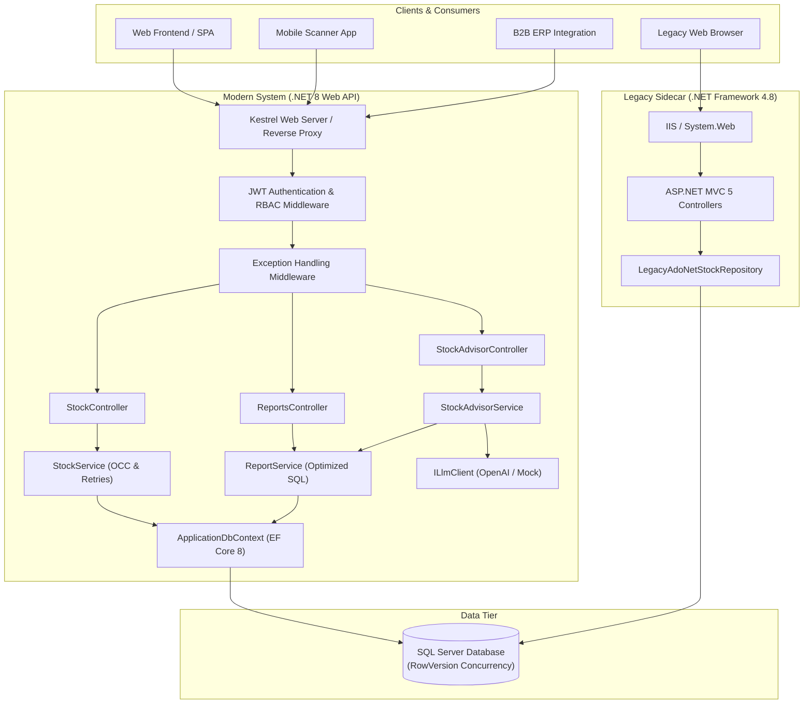
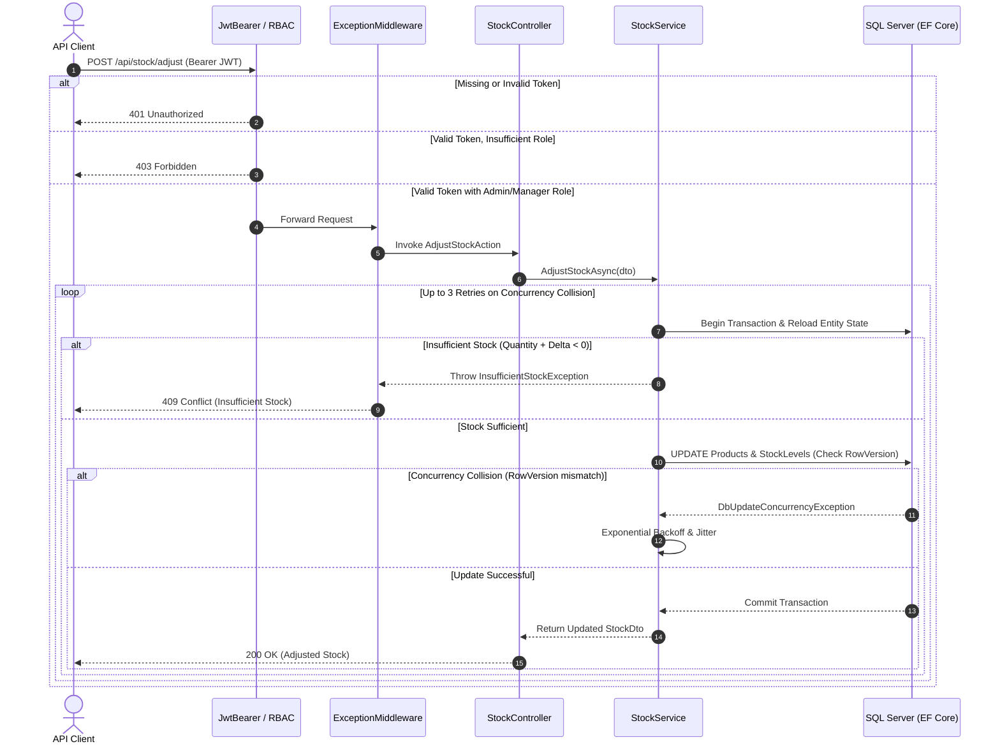
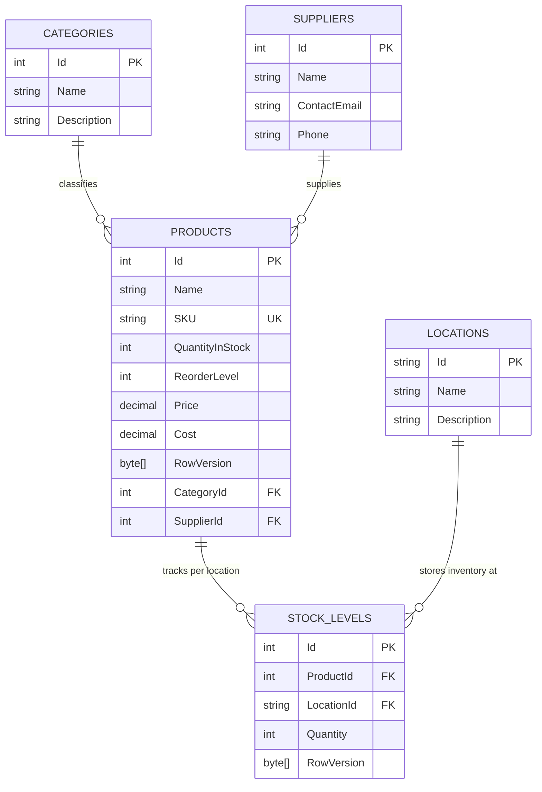
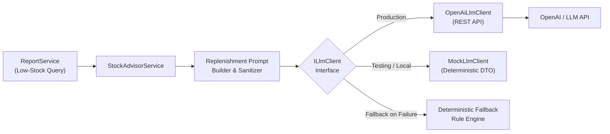

# StockFlow System Architecture

StockFlow is an enterprise-grade Inventory Management System providing high-throughput stock tracking, multi-warehouse inventory reconciliation, optimistic concurrency control, and AI-assisted replenishment planning.

---

## 1. Solution Architecture Overview

StockFlow is structured around a modern cloud-native .NET 8 Web API while maintaining an isolated legacy .NET Framework 4.8 ASP.NET MVC 5 sidecar to demonstrate real-world brownfield enterprise coexistence and migration patterns.

---

## 2. Request Lifecycle & Middleware Pipeline

All incoming HTTP requests to the modern Web API traverse a structured ASP.NET Core middleware pipeline designed for security, error isolation, and operational logging.

---

## 3. Data Model & Entity Relationships

The relational schema coordinates inventory across catalog summaries and physical warehouse locations:

---

## 4. Multi-Warehouse Stock Synchronization

To preserve zero breaking changes for existing catalog consumers while offering warehouse-level granularity, StockFlow synchronizes catalog totals atomically:

1. **Warehouse-Specific Adjustments (`POST /api/stock/adjust` with `LocationId`):**
   - Validates that `LocationId` exists in `Locations`.
   - Loads the specific `StockLevel` row and the aggregate `Product` row within a single database transaction.
   - Verifies that `StockLevel.Quantity + Delta >= 0` and `Product.QuantityInStock + Delta >= 0`.
   - Modifies `StockLevel.Quantity` and `Product.QuantityInStock` simultaneously.
   - Evaluates optimistic concurrency tokens (`RowVersion`) on both entities before committing.

2. **Catalog-Level Adjustments (`POST /api/stock/adjust` without `LocationId`):**
   - Directly updates `Product.QuantityInStock` with concurrency retry handling.
   - Preserves backward compatibility for automated integrations that do not track physical warehouse bins.

---

## 5. AI Replenishment Advisor Architecture

The AI Replenishment Advisor integrates automated stock replenishment with LLMs through a provider-agnostic abstraction:

- **Resilience:** If the LLM provider experiences network latency, rate limits, or invalid API credentials, `StockAdvisorService` automatically falls back to an algorithmic calculation:
  $$\text{ReorderQuantity} = \max((\text{ReorderLevel} \times 2) - \text{CurrentStock}, 10)$$
- **Security:** Product identifiers and quantities are formatted without leaking internal database keys, customer identifiers, or proprietary margins to external LLMs.
