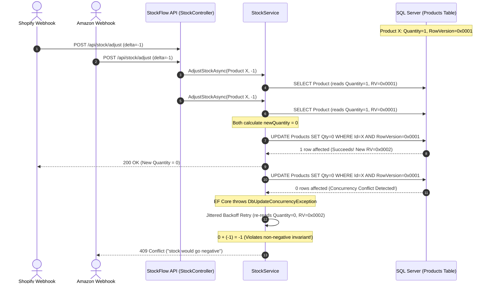

# Multi-Channel Inventory Synchronization & Concurrency Architecture

> **Domain Case Study: Solving the "Double-Selling" Dilemma in Modern E-Commerce Platforms**  
> *Targeted for Cin7 Multi-Channel SaaS Operations (Shopify, Amazon, WooCommerce, In-Store POS).*

---

## 1. The Multi-Channel Problem Statement

In omnichannel commerce (Cin7's core vertical), a merchant sells inventory across multiple disconnected storefronts and marketplaces simultaneously:
- **Shopify Online Store**
- **Amazon Marketplace**
- **In-Store Retail POS**
- **B2B Wholesale Portal**

All channels typically fulfill from a shared central warehouse inventory pool.

### The Race Condition Scenario:
Imagine a high-value product with **1 unit remaining in stock**:
1. At `12:00:00.100`, Customer A purchases the unit on **Shopify**.
2. At `12:00:00.105`, Customer B purchases the unit on **Amazon**.
3. Both channel listeners issue `POST /api/stock/adjust` with `delta = -1`.
4. In naive inventory systems without strict concurrency locking:
   - Request A reads `Quantity = 1`.
   - Request B reads `Quantity = 1`.
   - Request A writes `Quantity = 0` (Succeeds).
   - Request B writes `Quantity = 0` or `-1` (Succeeds).
5. **Outcome**: The seller has sold 2 physical units when only 1 exists, triggering fulfillment failure, order cancellation, and Amazon seller account demerits.

---

## 2. StockFlow's Concurrency Protection Architecture

StockFlow solves this race condition using **Optimistic Concurrency Control** backed by SQL Server's native `rowversion` column and Entity Framework Core 8.



---

## 3. Implementation Breakdown in StockFlow

### 1. Database Model Concurrency Token
In `Models/Product.cs`, the entity declares a byte array decorated as a concurrency token:
```csharp
[Timestamp]
public byte[]? RowVersion { get; set; }
```
In SQL Server, EF Core configures this column as `ROWVERSION` (`TIMESTAMP`). The SQL Server storage engine automatically assigns a monotonically increasing binary number whenever a record is inserted or updated.

### 2. Jittered Exponential Backoff in `StockService.cs`
When concurrent webhooks arrive simultaneously, StockFlow does not fail immediately. It attempts an intelligent retry loop with randomized jitter:
```csharp
for (int attempt = 1; attempt <= maxRetries; attempt++)
{
    try
    {
        var product = await _productRepository.GetByIdAsync(productId, cancellationToken);
        if (product == null) return (false, 404, "product not found", 0);

        if (product.QuantityInStock + delta < 0)
        {
            return (false, 409, "stock would go negative", product.QuantityInStock);
        }

        product.QuantityInStock += delta;
        await _unitOfWork.SaveChangesAsync(cancellationToken);
        return (true, 200, "Stock adjusted successfully.", product.QuantityInStock);
    }
    catch (DbUpdateConcurrencyException) when (attempt < maxRetries)
    {
        // Add random jitter between 25ms and 75ms to desynchronize concurrent threads
        var jitterMs = Random.Shared.Next(25, 75);
        await Task.Delay(jitterMs, cancellationToken);
    }
}
```

### 3. Verification Under Load
StockFlow includes an automated integration test (`StockEndpointIntegrationTests.cs`) simulating **20 parallel concurrent stock deductions** against an item with only 10 available units. Under concurrent execution:
- Exactly **10 requests succeed (HTTP 200)**.
- Exactly **10 requests are rejected (HTTP 409 Conflict)** with `"stock would go negative"`.
- The final verified database quantity is guaranteed to be exactly **0** (never negative).

---

## 4. Multi-Warehouse & Channel Allocation Mapping

In a full enterprise deployment, this pattern extends to **Warehouse Locations**:
- `Available Stock` = `Total Physical Stock` - `Allocated / Reserved Stock`.
- Stock adjustments from POS directly decrement physical inventory.
- Stock adjustments from e-commerce channels place a reservation hold prior to warehouse dispatch, all guarded by the same atomic concurrency guarantees.
