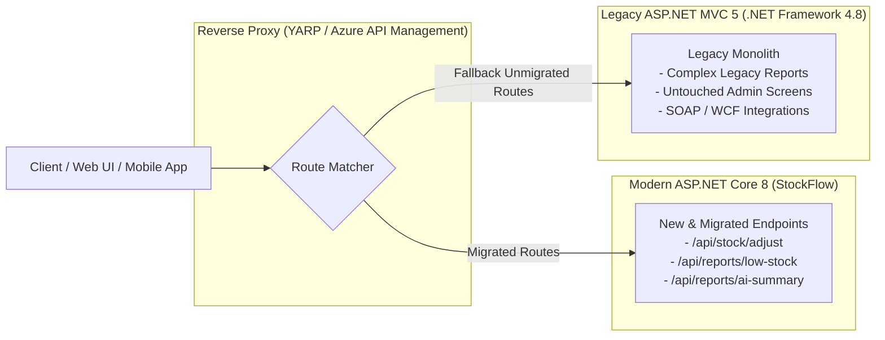

# Enterprise .NET Modernization: Migrating from .NET Framework (Legacy) & ASP.NET MVC 5 to .NET 8

> **Architectural Whitepaper & Migration Case Study**  
> *Prepared for engineering teams modernizing cloud-based inventory SaaS platforms (e.g., Cin7, StockFlow).*

---

## 1. Executive Summary

Enterprise SaaS platforms in the inventory and supply chain domain (such as Cin7) frequently manage codebases that span two technological eras:
1. **Legacy Foundation**: Core services and ERP integrations built over the past decade on **.NET Framework 4.x (4.7.2 / 4.8)** using **ASP.NET MVC 5** and **Web API 2**.
2. **Modern Platform**: High-throughput REST APIs, microservices, and AI-assisted workflows built on modern, cross-platform **.NET 8** and **ASP.NET Core**.

Attempting a "big-bang" rewrite of a mission-critical inventory platform introduces unacceptable business risk (downtime, order routing errors, corrupted warehouse reconciliations). Therefore, senior and junior engineers alike must master **incremental migration strategies** (such as the *Strangler Fig* pattern) and understand the architectural contracts of both platforms.

---

## 2. Deep Architectural Comparison: Legacy vs. Modern .NET

| Architectural Dimension | Legacy: .NET Framework 4.8 / ASP.NET MVC 5 | Modern: .NET 8 / ASP.NET Core |
| :--- | :--- | :--- |
| **Runtime & Platform** | Windows-only CLR. Tied to Windows OS and Global Assembly Cache (GAC). | Cross-platform CoreCLR (Linux, Windows, macOS, containers). Lightweight and modular. |
| **Hosting Model** | Strongly coupled to **IIS** (`w3wp.exe`) via ISAPI or ASP.NET pipeline. | InProcess IIS (ANCM) or Self-Hosted via **Kestrel** (high-performance asynchronous web server). |
| **Application Lifecycle** | `Global.asax.cs` handling `HttpApplication` events (`Application_Start`, `Application_BeginRequest`). | [Program.cs](file:///c:/Users/Deeksha/OneDrive/Desktop/StockFlow%20—%20Inventory%20Management%20System%20API/Program.cs) unified `WebApplicationBuilder` with generic hosting. |
| **Pipeline & Filtering** | Heavyweight `IHttpModule` and `IHttpHandler` traversing 20+ pipeline events. | Lightweight `RequestDelegate` Middleware pipeline (`app.Use(...)`) with linear execution order. |
| **Dependency Injection** | No built-in IoC. Required third-party containers (Autofac, Unity, Castle Windsor) wired in `App_Start`. | First-class native DI (`IServiceCollection`, `IServiceProvider`) with Scoped, Transient, and Singleton lifecycles. |
| **Configuration** | Static XML files (`web.config`, `app.config`) parsed via `ConfigurationManager.AppSettings`. | Hierarchical JSON (`appsettings.json`), environment variables, user secrets, and Azure App Configuration via `IConfiguration`. |
| **Controllers & Routing** | Split hierarchy: `System.Web.Mvc.Controller` (Razor) vs `System.Web.Http.ApiController` (Web API). | Unified `Microsoft.AspNetCore.Mvc.ControllerBase` and `Controller` for both REST APIs and Razor Views. |
| **Data Access & ORM** | **Entity Framework 6**: EDMX XML or Code-First, heavy reflection, synchronous defaults, global DbContext state. | **Entity Framework Core 8**: High-speed compiled queries, shadow properties, native async, split queries, and optimistic concurrency tokens (`RowVersion`). |
| **Threadpool & Asynchrony** | Synchronous blocking calls (`.Result`, `.Wait()`) caused frequent thread pool starvation on IIS. | Fully non-blocking async/await (`Task`, `ValueTask`, `CancellationToken`) throughout all layers. |

---

## 3. Concrete Code Evolution: Stock Adjustment Controller

### Legacy ASP.NET MVC 5 / Web API 2 (.NET Framework 4.8)

In legacy systems, controllers relied on static context (`HttpContext.Current`), manual service resolution or service locators, and synchronous database operations:

```csharp
// LEGACY: ASP.NET MVC 5 / Web API 2 on .NET Framework 4.8
using System.Web;
using System.Web.Http;
using System.Data.Entity; // EF 6

namespace LegacyInventory.Controllers
{
    [RoutePrefix("api/stock")]
    public class LegacyStockController : ApiController
    {
        private readonly LegacyDbContext _db = new LegacyDbContext();

        [HttpPost]
        [Route("adjust")]
        public IHttpActionResult AdjustStock(StockAdjustmentRequest request)
        {
            if (!ModelState.IsValid)
            {
                return BadRequest(ModelState);
            }

            // Blocking synchronous database call
            var product = _db.Products.Find(request.ProductId);
            if (product == null)
            {
                return NotFound();
            }

            if (product.QuantityInStock + request.Delta < 0)
            {
                return Conflict();
            }

            product.QuantityInStock += request.Delta;
            _db.SaveChanges(); // Synchronous write - locks IIS thread pool worker

            return Ok(new { ProductId = product.Id, Quantity = product.QuantityInStock });
        }

        protected override void Dispose(bool disposing)
        {
            if (disposing) _db.Dispose();
            base.Dispose(disposing);
        }
    }
}
```

### Modern ASP.NET Core 8 (.NET 8) in StockFlow

In StockFlow, the exact same business requirement is implemented using dependency injection, asynchronous execution, cancellation tokens, and database concurrency protection:

```csharp
// MODERN: ASP.NET Core 8 in StockFlow
using InventoryManagementSystemAPI.DTOs.Stock;
using InventoryManagementSystemAPI.Services.Interfaces;
using Microsoft.AspNetCore.Mvc;

namespace InventoryManagementSystemAPI.Controllers
{
    [ApiController]
    [Route("api/[controller]")]
    public class StockController : ControllerBase
    {
        private readonly IStockService _stockService;

        // Injected via built-in Dependency Injection container
        public StockController(IStockService stockService)
        {
            _stockService = stockService;
        }

        [HttpPost("adjust")]
        public async Task<IActionResult> AdjustStock(
            [FromBody] AdjustStockDto dto, 
            CancellationToken cancellationToken)
        {
            // Fully asynchronous with database-level concurrency (RowVersion / DbUpdateConcurrencyException)
            var (success, statusCode, message, newQuantity) = 
                await _stockService.AdjustStockAsync(dto.ProductId, dto.Delta, cancellationToken);

            if (!success)
            {
                return StatusCode(statusCode, new { message });
            }

            return Ok(new 
            { 
                productId = dto.ProductId, 
                quantity = newQuantity, 
                message 
            });
        }
    }
}
```

---

## 4. Enterprise Migration Strategies



### 1. The Strangler Fig Pattern with YARP
Rather than rewriting the entire SaaS inventory system simultaneously:
1. Deploy **YARP (Yet Another Reverse Proxy)** in front of both the legacy IIS server and the modern ASP.NET Core 8 service.
2. Route high-priority, high-concurrency endpoints (such as `api/stock/adjust` and `api/products`) directly to the modern ASP.NET Core 8 application.
3. Catch-all and fallback unmigrated routes to the existing legacy ASP.NET MVC 5 site.
4. As endpoints are migrated one-by-one, change route definitions in YARP with zero customer downtime.

### 2. Shared Domain Contracts via `.NET Standard 2.0`
- `.NET Standard 2.0` is supported by both **.NET Framework 4.6.1+** and **.NET 8**.
- Common domain classes (such as `Product`, `PurchaseOrder`, inventory calculation math, and DTOs) can be housed in a shared `.NET Standard 2.0` library.
- Both legacy MVC 5 projects and new ASP.NET Core 8 services reference the exact same business logic simultaneously, preventing divergence.

### 3. Incremental Database Migration: EF6 to EF Core 8
1. **Shared Database**: Keep the single production SQL Server database active.
2. **Concurrency Tokens**: Transition legacy manual timestamp checks to EF Core's native `[Timestamp]` byte array (`RowVersion`), allowing both legacy and modern systems to detect concurrent modifications safely.
3. **Raw SQL Transition**: Port legacy SQL stored procedures and complex joins to EF Core's `FromSqlInterpolated` and Dapper queries for maximum performance without EF overhead.

---

## 5. Architectural Checklist for Cin7 Engineers

- [x] **Eliminate `HttpContext.Current`**: Never use static state; inject `IHttpContextAccessor` if HTTP context is required in services.
- [x] **Enforce Non-Blocking Asynchrony**: Replace all `.Wait()`, `.Result`, and `Thread.Sleep()` with `await` and `Task.Delay()` to prevent IIS thread exhaustion.
- [x] **Secure Configuration Injection**: Shift from XML `web.config` keys to strongly typed options (`IOptions<JwtOptions>`) hydrated from environment variables or Azure Key Vault.
- [x] **Cross-Platform Readiness**: Avoid Windows-specific dependencies (e.g., Windows Registry, GDI+ System.Drawing, MSMQ) to allow seamless deployment on Linux containers or Azure App Service.
