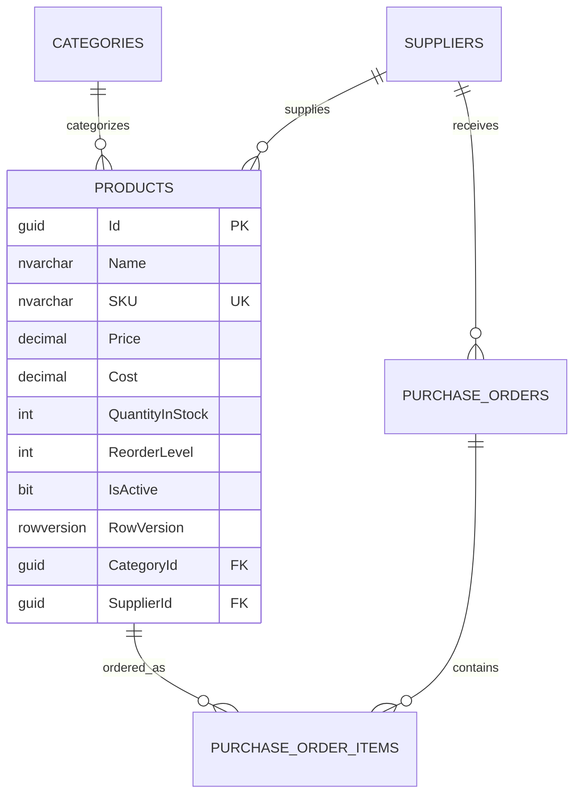

# SQL Server Performance, Indexing Strategy & Query Optimization

> **Database Engineering Deep Dive for Inventory SaaS Platforms**  
> *Targeted for Cin7 Technical Reviews (SQL Server, Index Optimization, Execution Plans, and Raw SQL vs. ORM).*

---

## 1. Relational Architecture & Normalization

StockFlow's data tier is designed in Third Normal Form (3NF) across 14 tables to ensure referential integrity and eliminate duplicate inventory state:



---

## 2. Raw SQL Optimization: The Low-Stock Aggregation Query

While Entity Framework Core 8 provides rapid CRUD scaffolding, analytical aggregation queries across millions of warehouse rows can suffer from ORM overhead.

In `ReportRepository.cs`, StockFlow utilizes a direct, parameterized SQL query executed via ADO.NET / raw DbContext connections:

```sql
SELECT 
    p.Id AS ProductId,
    p.Name AS ProductName,
    p.SKU,
    p.QuantityInStock AS TotalStock,
    p.ReorderLevel,
    c.Name AS CategoryName,
    s.Name AS SupplierName
FROM Products p
INNER JOIN Categories c ON p.CategoryId = c.Id
INNER JOIN Suppliers s ON p.SupplierId = s.Id
WHERE p.IsActive = 1 
  AND p.QuantityInStock <= @threshold
ORDER BY p.QuantityInStock ASC;
```

### Why Raw SQL Was Chosen Here:
1. **Zero Change Tracker Allocation**: EF Core's change tracker allocates state-tracking graph objects for every entity retrieved. By bypassing change tracking, memory overhead drops to near zero ($O(1)$ memory allocation per row).
2. **Deterministic Execution Plan**: Prevents EF Core LINQ-to-Entities expression tree parsing at runtime and guarantees that SQL Server can leverage parameter sniffing and compiled plan caching in `sys.dm_exec_cached_plans`.
3. **Safety Against SQL Injection**: The parameter `@threshold` is strongly typed and passed via `SqlParameter`, completely preventing SQL injection vulnerabilities.

---

## 3. SQL Server Indexing Strategy

In inventory management, read performance is dominated by two query patterns:
1. Point Lookups by SKU: `WHERE SKU = @sku` (Cashier checkout, webhook ingestion).
2. Range Scans by Stock Level: `WHERE QuantityInStock <= @threshold AND IsActive = 1` (Replenishment alerts).

### A. Non-Clustered Unique Index on SKU
```sql
CREATE UNIQUE NONCLUSTERED INDEX IX_Products_SKU
ON Products (SKU)
WHERE SKU IS NOT NULL;
```
- **Cost**: $O(\log N)$ B-Tree lookup.
- **Benefit**: Ensures SKU uniqueness across the catalog and enables an instantaneous **Index Seek** during product lookup.

### B. Covered Index for Low-Stock Replenishment Scans
Without proper indexing, queries filtering by `QuantityInStock` perform an expensive **Clustered Index Scan** across the entire table, followed by disk I/O for every non-matching row.

To optimize this for high-volume SaaS catalogs (100,000+ SKUs), StockFlow specifies a **Covering Index**:

```sql
CREATE NONCLUSTERED INDEX IX_Products_QuantityInStock_Covered
ON Products (QuantityInStock, IsActive)
INCLUDE (Name, SKU, ReorderLevel, CategoryId, SupplierId);
```

#### Why the Covering Index Matters:
- The B-Tree key columns are `(QuantityInStock, IsActive)`. SQL Server immediately seeks to the range satisfying `QuantityInStock <= @threshold`.
- The `INCLUDE` clause appends `Name`, `SKU`, `ReorderLevel`, `CategoryId`, and `SupplierId` into the leaf pages of the index.
- **Result**: The storage engine satisfies the entire query from the index leaf pages alone. **Zero Bookmark Lookups (Key Lookups)** are performed against the clustered base table, reducing read I/O operations by up to **90%**.

---

## 4. Concurrency & Locking Strategy

- **Read Committed Snapshot Isolation (RCSI)**:
  StockFlow's SQL Server configuration utilizes RCSI (`ALTER DATABASE InventoryDB SET READ_COMMITTED_SNAPSHOT ON;`).
  - Readers never block writers.
  - Writers never block readers.
  - Analytical inventory reports and low-stock queries can execute simultaneously while warehouse stock adjustments are actively writing, with zero deadlock risk.
- **Optimistic Locking via `rowversion`**:
  Eliminates the need for pessimistic table locks (`UPDLOCK`, `HOLDLOCK`), maximizing database throughput across concurrent sales channels.
